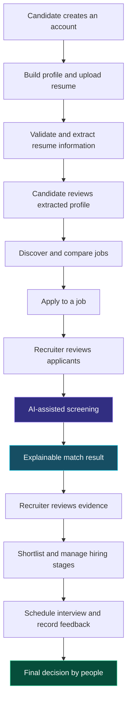
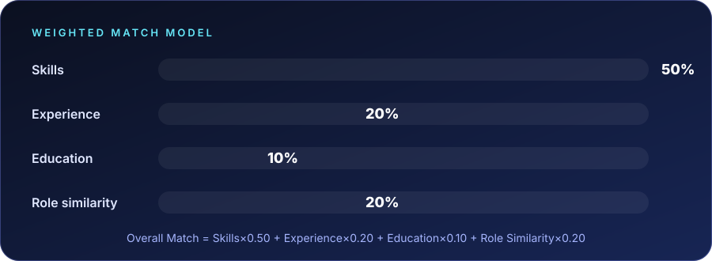
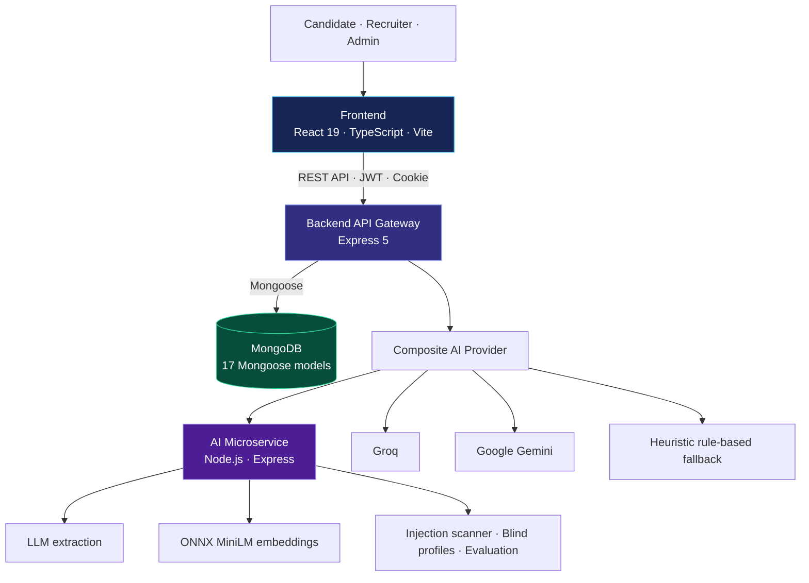

<a id="top"></a>

<div align="center">

  

  

  <p>
    
  </p>

  <p>
    
    
    
    
    
    
  </p>

  <p>
    
    
    
    
    
    
  </p>

  <p>
    <a href="#-overview"></a>
    <a href="#-how-it-works"></a>
    <a href="#-features"></a>
    <a href="#-ai-matching-engine"></a>
    <a href="#-architecture"></a>
    <a href="#-getting-started"></a>
  </p>

  <h3>Recruitment, redesigned around evidence.</h3>
  <p><b>HireSmart AI</b> helps candidates discover relevant opportunities and helps recruiters evaluate applications<br/>using structured resume insights and explainable AI-assisted matching.</p>

</div>


## ✦ Overview

Hiring teams often receive more resumes than they can carefully review. Candidates, meanwhile, may struggle to understand which roles fit their skills and where they need to improve.

**HireSmart AI brings both sides into one recruitment platform.** It extracts useful information from resumes, compares candidate evidence with job requirements, explains match results, and supports the recruitment process from application to interview.

The platform has three role-based experiences:

<table>
<tr>
<td width="33%" valign="top">

### 🧑‍💻 Candidate
Build a profile, upload a resume, explore jobs, understand skill gaps, apply, and track progress.

</td>
<td width="33%" valign="top">

### 🧭 Recruiter
Publish jobs, discover candidates, run AI-assisted screening, review evidence, manage applicants, and schedule interviews.

</td>
<td width="33%" valign="top">

### 🛡️ Administrator
Manage users and jobs, review complaints, maintain skills, inspect audit logs, and monitor platform health.

</td>
</tr>
</table>

> [!IMPORTANT]
> **Our principle:** AI supports recruitment decisions. It does not make the final hiring decision or automatically reject candidates.


## ✦ The problem and our approach

| Recruitment challenge | How HireSmart AI helps |
|:--|:--|
| ⏱️ Manually reviewing large numbers of resumes takes time. | Extracts structured candidate information and supports bulk screening. |
| 🔎 Keyword matching can miss relevant experience. | Combines evidence-based rules with semantic role similarity. |
| 📊 A single match percentage is difficult to interpret. | Shows component scores, strengths, missing skills, and suggestions. |
| 🤔 Candidates may not know why a role is or is not a good fit. | Provides job-fit insights and skill-gap analysis. |
| 🧨 Resume content can contain misleading or malicious instructions. | Scans suspicious content and sanitizes model input. |
| ⚖️ Hiring decisions need accountability. | Keeps recruiters in control and provides audit and evaluation capabilities. |


## ✦ How it works

The platform follows a straightforward recruitment journey.



### 💡 A simple example

Imagine a recruiter publishes a **Data Analyst** role that requires SQL, Python, Excel, and data visualization.

1. A candidate uploads a PDF or DOCX resume.
2. HireSmart AI extracts skills, education, experience, and project evidence.
3. The candidate reviews the extracted information before it is saved to their profile.
4. The matching engine compares the candidate's evidence with the job requirements.
5. The recruiter sees an overall score, component scores, strengths, and skill gaps.
6. The recruiter reviews the candidate and decides what happens next.

> [!NOTE]
> The score is a **job-relevance signal**, not a probability of being hired or succeeding in the role.


## ✦ Features

<details open>
<summary><b>🧑‍💻 &nbsp;01 · Candidate experience</b></summary>

<br/>

- Candidate registration, login, and Google OAuth.
- Profile creation and management.
- PDF and DOCX resume upload.
- Resume parsing and structured information extraction.
- Resume quality insights and skill-gap analysis.
- Job search, filters, bookmarks, and personalized recommendations.
- Job-fit checks and application submission.
- Application status and timeline tracking.
- Interview schedule visibility and notifications.

</details>

<details>
<summary><b>🧭 &nbsp;02 · Recruiter experience</b></summary>

<br/>

- Recruiter profile and organization management.
- Job creation, editing, publishing, and closing.
- Structured job requirement extraction.
- Candidate discovery and filtering.
- Individual and bulk AI-assisted resume screening.
- Explainable match scores and candidate evidence.
- Blind candidate profile review.
- Shortlisting and hiring-pipeline management.
- Interview scheduling, feedback, and ratings.
- Recruitment funnel analytics.

</details>

<details>
<summary><b>🛡️ &nbsp;03 · Administrator experience</b></summary>

<br/>

- Platform metrics and system-health monitoring.
- User search, moderation, suspension, and reactivation.
- Job moderation.
- Complaint triage and resolution notes.
- Skill taxonomy management and unknown-skill review.
- Audit-log search and pagination.
- AI fairness, stability, extraction, and security evaluation views.

</details>

<details>
<summary><b>🔐 &nbsp;04 · AI, privacy, and security</b></summary>

<br/>

- Hybrid semantic and rule-based matching.
- Evidence-based skill scoring.
- Local ONNX MiniLM embeddings.
- Four-tier AI provider fallback.
- Prompt-injection pattern scanning.
- Selected personally identifiable information (PII) sanitization before external AI calls.
- Blind candidate profiles to reduce exposure to selected identifiers.
- Review-before-save flow for extracted candidate information.
- Sanitized audit events.

</details>


## ✦ AI matching engine

HireSmart AI uses a weighted model to compare candidate information with a job's requirements.

<div align="center">

  

</div>

```text
Overall Match =
    (Skills Match      × 0.50) +
    (Experience Match  × 0.20) +
    (Education Match   × 0.10) +
    (Role Similarity   × 0.20)
```

| Matching dimension | Weight | What it evaluates |
|:--|:--:|:--|
| 🎯 Skills | **50%** | Required and preferred skills supported by resume evidence. |
| 💼 Experience | **20%** | Dated work history and the experience range requested by the job. |
| 🎓 Education | **10%** | Alignment with the job's education requirements. |
| 🧠 Role similarity | **20%** | Relevance between the candidate's experience and the target role. |

### 🧮 How skill scoring works

The engine looks for evidence of a skill, rather than relying only on how many times a word appears.

| Evidence in the resume | Contribution |
|:--|--:|
| Skill mentioned | +30 |
| Listed in the skills section | +10 |
| Used in each experience role | +12, capped at 25 |
| Used in each project | +10, capped at 20 |
| Years in roles using the skill | +5 per year, capped at 15 |

Additional controls:

- Required skills contribute **80%** of the skill score; preferred skills contribute **20%**.
- Partial skill matches receive **0.5** credit.
- Excessive skills listed without supporting evidence are down-weighted.
- When dated roles exist, effective experience uses the lower of stated and computed years.
- Overlapping employment periods are not double-counted.

### 🧠 Semantic role similarity

Role similarity combines two approaches:

- **60% semantic similarity:** local MiniLM embeddings compare the meaning of role and experience descriptions.
- **40% rule-based similarity:** deterministic rules compare role-related information.

This hybrid approach can recognize related experience even when a resume and job description use different wording.

### 🏷️ Match interpretation

<div align="center">

| Match category | Default score |
|:--:|:--:|
| 🟢 **Strong Match** | **80 and above** |
| 🟡 **Potential Match** | **60 – 79** |
| 🔴 **Low Match** | **Below 60** |

</div>

> [!TIP]
> The thresholds and matching weights are configurable. A match score is not a hiring probability, and recruiters should review the underlying evidence.


## ✦ Architecture

HireSmart AI follows a **gateway-centred, three-service architecture**. The Express backend coordinates authentication, authorization, data access, and AI-provider communication. The browser does not call the internal AI microservice directly.



### 🧩 Services and responsibilities

| Service | Default port | Responsibility |
|:--|:--:|:--|
| 🖥️ Frontend | `5173` | Role-based interfaces, navigation, dashboards, forms, charts, and API clients. |
| ⚙️ Backend | `5000` | REST API, authentication, authorization, validation, business logic, persistence, and provider orchestration. |
| 🤖 AI service | `8000` | Resume and job extraction, injection scanning, semantic embeddings, matching, blind profiles, and evaluation. |
| 🗄️ MongoDB | `27017` | Persistent storage for identity, profiles, jobs, applications, interviews, notifications, governance, and evaluation data. |

### 🔁 AI provider fallback

The backend's `CompositeAIProvider` uses this ordered provider chain:

1. **AI microservice** — dedicated AI-service endpoints.
2. **Direct Groq** — JSON chat completion using the configured Groq API key.
3. **Google Gemini** — JSON-generation fallback.
4. **Heuristic rule-based provider** — deterministic in-process matching when external providers are unavailable.

> [!NOTE]
> This fallback design helps preserve core matching workflows when a provider is unavailable. Provider-dependent extraction still requires valid credentials and model availability.


## ✦ Technology stack

<div align="center">
  
</div>

<br/>

| Layer | Technologies |
|:--|:--|
| 🖥️ Frontend | React 19, TypeScript, Vite 8, Tailwind CSS 4, React Router DOM 7, Framer Motion 13, Recharts 3, Lucide React, OGL |
| ⚙️ Backend | Node.js, Express 5, TypeScript, Mongoose 9, Zod 4, JWT, bcryptjs, Google Auth Library, Multer, pdf-parse, Mammoth, Nodemailer, Helmet, express-rate-limit |
| 🤖 AI service | Node.js ESM, Express 5, Groq SDK, Hugging Face Transformers.js, ONNX Runtime, PDF.js, Mammoth, Zod |
| 🧠 AI models | `openai/gpt-oss-20b` (configured Groq model), `onnx-community/all-MiniLM-L6-v2-ONNX` |
| 🗄️ Database | MongoDB 7+ with 17 Mongoose models |
| 🧪 Testing | TypeScript integration and E2E suites, Playwright Chromium, Python Selenium smoke test, AI-service phase 1–8 scripts |
| 🚀 Infrastructure | Docker, Docker Compose, Nginx, TLS overlay, Kubernetes manifests, Jenkins, shell CI scripts |


## ✦ Security, privacy, and responsible AI

Security and privacy are considered across authentication, API access, file uploads, AI inference, and auditability.

| Area | Implementation |
|:--|:--|
| 🔑 Passwords | bcryptjs password hashing. |
| 🍪 Sessions | Short-lived JWT access tokens and rotating HTTP-only refresh cookies. |
| 🛂 Authorization | Backend authentication and role-based authorization middleware. |
| 🌐 OAuth | Google OAuth 2.0 state validation and admin privilege-escalation protection. |
| 🔗 Internal AI requests | `x-internal-key` authentication with constant-time comparison. |
| 📎 File validation | PDF/DOCX magic-byte validation and extension/content mismatch rejection. |
| 📏 Upload limits | Backend upload cap of 10 MB; AI parser cap of 5 MB. |
| 🕵️ PII protection | Selected emails, phone numbers, and URLs are masked before outbound AI calls. |
| 🧱 HTTP protection | Helmet, strict CORS allowlists, rate limiting, and API documentation CSP. |
| 📜 Auditability | Sanitized audit events for important platform and AI operations. |

### 🧨 Prompt-injection defence

The AI service scans for eight instruction-pattern categories and invisible/zero-width character anomalies:

<div align="center">


</div>

Flagged lines are replaced with:

```text
[REMOVED: instruction-like content]
```

Suspicious content is surfaced for review instead of silently treating the resume as invalid.

### 🕶️ Blind screening

The blind-profile workflow pseudonymizes candidates (for example, `Candidate XXXX`) and redacts selected identifiers such as names, contact details, locations, company names, institution names, and—by default—education dates.

> [!WARNING]
> Blind screening helps reduce exposure to direct identifiers, but it does **not** guarantee anonymity. Free-text resume content may still contain identifying clues.

### ⚖️ Responsible AI principles

- AI provides evidence and recommendations; people make final hiring decisions.
- Match explanations show component scores, matched skills, missing skills, strengths, and gaps.
- Evaluation tools support fairness, stability, extraction, and security testing.
- Matching focuses on job-related information rather than direct personal identifiers.
- Candidates review extracted profile information before it overwrites saved profile data.
- Fairness and security tests support governance; they do not by themselves prove that a system is unbiased or legally compliant.


## ✦ Dashboard routes

<details>
<summary><b>🧑‍💻 &nbsp;Candidate dashboard</b></summary>

<br/>

| Route | Purpose |
|:--|:--|
| `/candidate/dashboard` | Application counts, profile completion, and recent statuses. |
| `/candidate/resume` | Upload, switch, download, and inspect resumes. |
| `/candidate/resume/analysis` | Review resume quality and extracted profile information. |
| `/candidate/jobs` | Search and filter jobs. |
| `/candidate/jobs/:jobId` | View job details, check fit, and apply. |
| `/candidate/recommended` | Personalized job recommendations. |
| `/candidate/applications` | Track application statuses. |
| `/candidate/applications/:applicationId` | View application history and interview details. |
| `/candidate/skills` | Review skills, proficiency, demand, gaps, and career paths. |
| `/candidate/profile` | Manage personal, education, experience, skills, and links. |
| `/candidate/profile/preview` | Preview the candidate profile. |
| `/candidate/settings` | Manage preferences. |
| `/candidate/complaint` · `/candidate/help` | Submit support requests and access help. |

</details>

<details>
<summary><b>🧭 &nbsp;Recruiter dashboard</b></summary>

<br/>

| Route | Purpose |
|:--|:--|
| `/recruiter/dashboard` | Active jobs, applicants, screened candidates, and interviews. |
| `/recruiter/jobs` | Manage job postings. |
| `/recruiter/jobs/create` | Create a job with structured requirements. |
| `/recruiter/jobs/:jobId` | View job details and applicant statistics. |
| `/recruiter/jobs/:jobId/edit` | Edit job information. |
| `/recruiter/candidates` | Search and filter the talent pool. |
| `/recruiter/candidates/:candidateId` | Inspect candidate information. |
| `/recruiter/screening` | Open the AI screening hub. |
| `/recruiter/screening/:jobId` | Run individual or bulk screening. |
| `/recruiter/screening/:jobId/:candidateId` | Review an individual match explanation. |
| `/recruiter/shortlist` · `/recruiter/hiring` | Manage shortlisted applicants and hiring stages. |
| `/recruiter/interviews` | Schedule and manage interviews. |
| `/recruiter/interviews/:interviewId` | Record feedback, ratings, and outcomes. |
| `/recruiter/analytics` | Review recruitment funnel metrics. |

</details>

<details>
<summary><b>🛡️ &nbsp;Administrator dashboard</b></summary>

<br/>

| Route | Purpose |
|:--|:--|
| `/admin` | Platform-wide users, jobs, applications, resumes, and trends. |
| `/admin/users` · `/admin/users/:userId` | Search, inspect, suspend, and reactivate users. |
| `/admin/complaints` · `/admin/complaints/:complaintId` | Triage complaints and record resolution notes. |
| `/admin/skills` | Manage skill taxonomy and unknown skills. |
| `/admin/audit-logs` | Search and paginate audit events. |
| `/admin/ai-evaluation` | Review AI fairness, stability, extraction, and security evaluations. |
| `/admin/system-health` | Inspect API, MongoDB, AI service, latency, memory, and uptime. |

</details>


## ✦ Data management and auditability

The `hiresmart` MongoDB database uses 17 Mongoose models.

| Domain | Models |
|:--|:--|
| 🔐 Identity and authentication | `User`, `RefreshToken`, `AuthToken` |
| 👥 Profiles and talent | `CandidateProfile`, `RecruiterProfile`, `Resume`, `Skill` |
| 🔄 Hiring workflow | `Job`, `Application`, `MatchResult`, `Shortlist`, `Interview`, `ScreeningSettings` |
| 🏛️ Governance and communication | `Notification`, `Complaint`, `AuditLog`, `AIEvaluation` |

Audit events cover authentication, resumes, AI screening, moderation, skills, and evaluation. Sensitive values such as passwords, tokens, secrets, and raw resume text are scrubbed from audit payloads.

Examples of AI audit events include `RESUME_ANALYZED`, `MATCH_SCORED`, `SCREENING_RUN`, `JOB_EXTRACTED`, `INJECTION_DETECTED`, and `EVALUATION_RUN`.


## ✦ Project structure

<details>
<summary><b>📁 &nbsp;Expand repository tree</b></summary>

```text
ResumeAI/
├── frontend/
│   ├── src/
│   │   ├── components/       # Shared UI, auth, protected routes, layouts
│   │   ├── config/           # Frontend environment configuration
│   │   ├── context/          # Authentication and domain contexts
│   │   ├── data/             # Offline mock datasets
│   │   ├── hooks/            # Reusable React hooks
│   │   ├── pages/            # Public, candidate, recruiter, admin views
│   │   ├── services/         # API clients and HTTP client
│   │   └── types/            # TypeScript domain interfaces
│   └── tests/                # Playwright and Selenium browser tests
├── backend/
│   ├── docs/                 # OpenAPI specification and Swagger assets
│   ├── src/
│   │   ├── config/           # Database and environment configuration
│   │   ├── controllers/      # REST request handlers
│   │   ├── middleware/       # Authentication, authorization, validation
│   │   ├── models/           # 17 Mongoose models
│   │   ├── routes/           # Versioned /api/v1 routes
│   │   ├── seed/             # Development database seed
│   │   ├── services/         # Business logic and AI provider orchestration
│   │   ├── utils/            # API, token, and file helpers
│   │   └── validators/       # Zod validation schemas
│   ├── tests/                # Integration and end-to-end suites
│   └── uploads/resumes/      # Local resume storage
├── ai-service/
│   ├── scripts/              # Phase 1–8 tests and model download
│   ├── samples/              # Sample resumes and fixtures
│   ├── src/
│   │   ├── audit/            # PII-free AI audit events
│   │   ├── blind/            # Pseudonymization and redaction
│   │   ├── evaluation/       # Fairness, stability, security tests
│   │   ├── extraction/       # Resume LLM extraction and schemas
│   │   ├── jobs/             # Job description extraction
│   │   ├── matching/         # Weighted scoring and parsers
│   │   ├── parsing/          # PDF/DOCX extraction and cleaning
│   │   ├── recommend/        # Job recommendation logic
│   │   ├── security/         # Prompt-injection scanner
│   │   ├── semantic/         # ONNX embeddings and cosine scoring
│   │   ├── server/           # Express app and internal-key auth
│   │   ├── skillgap/         # Skill-gap and career-path analysis
│   │   └── taxonomy/         # Skill aliases and normalization
│   └── API.md
├── assets/                   # Animated README SVGs
├── deploy/
│   ├── kubernetes/           # Kubernetes manifests
│   └── nginx/                # HTTPS reverse-proxy configuration
├── docs/                     # Architecture, API, test report, Postman
├── scripts/                  # CI scripts
├── docker-compose.yml
├── docker-compose.https.yml
├── Jenkinsfile
└── .env.example
```

</details>


## ✦ Getting started

### 📋 Prerequisites

- Node.js 20+ (the AI service requires Node.js 18+).
- MongoDB 7+.
- npm.
- Python 3 only for the optional Selenium smoke test.

### 1️⃣ Clone the repository

```bash
git clone https://github.com/tharunsai01/ResumeAI.git
cd ResumeAI
```

### 2️⃣ Install dependencies

Run the following commands from the repository root:

```bash
cd backend && npm install
cd ../ai-service && npm install
cd ../frontend && npm install
```

### 3️⃣ Configure environment files

Create local environment files from the provided examples:

- `backend/.env.example` → `backend/.env`
- `ai-service/.env.example` → `ai-service/.env`
- `frontend/.env.example` → `frontend/.env`
- Root `.env.example` → root `.env` for Docker Compose

### 4️⃣ Seed development data (optional)

```bash
cd backend
npm run seed
```

The seed script refuses to run when `NODE_ENV=production`.

### 5️⃣ Start the services

Run each service in a separate terminal.

**Terminal 1 — AI service**

```bash
cd ai-service
npm start
```

**Terminal 2 — Backend API**

```bash
cd backend
npm run dev
```

**Terminal 3 — Frontend**

```bash
cd frontend
npm run dev
```

Open **http://localhost:5173** in your browser.

### 6️⃣ Check service health

```bash
curl http://localhost:8000/health
curl http://localhost:5000/health
curl http://localhost:5000/api/v1/health
```


## ✦ Environment configuration

<details>
<summary><b>⚙️ &nbsp;Backend · backend/.env</b></summary>

```env
NODE_ENV=development
PORT=5000
MONGODB_URI=mongodb://127.0.0.1:27017/hiresmart
CLIENT_URL=http://localhost:5173
JWT_ACCESS_SECRET=replace_with_a_random_secret_at_least_32_chars
JWT_ACCESS_MINUTES=15
JWT_REFRESH_DAYS=7
AI_SERVICE_URL=http://127.0.0.1:8000
AI_SERVICE_KEY=replace_with_a_random_secret_at_least_16_chars
GROQ_API_KEY=
GEMINI_API_KEY=
OPENAI_API_KEY=
GOOGLE_CLIENT_ID=
GOOGLE_CLIENT_SECRET=
GOOGLE_REDIRECT_URI=http://localhost:5173/oauth/callback
SMTP_HOST=
SMTP_PORT=587
SMTP_USER=
SMTP_PASS=
EMAIL_FROM=no-reply@hiresmart.local
```

</details>

<details>
<summary><b>🤖 &nbsp;AI service · ai-service/.env</b></summary>

```env
PORT=8000
AI_SERVICE_KEY=must_match_backend_and_be_at_least_16_chars
GROQ_API_KEY=your_groq_api_key
GROQ_MODEL=openai/gpt-oss-20b
ALLOW_TXT_UPLOADS=false
# Optional: MAX_CONCURRENT_LLM=2
# Optional: MAX_LLM_QUEUE=50
# Optional embedding overrides: EMBEDDING_MODEL, EMBEDDING_DTYPE, EMBEDDING_CACHE_DIR
```

</details>

<details>
<summary><b>🖥️ &nbsp;Frontend · frontend/.env</b></summary>

```env
VITE_API_BASE_URL=http://localhost:5000/api/v1
VITE_USE_MOCK=false
VITE_GOOGLE_CLIENT_ID=
```

</details>

> [!CAUTION]
> **Security note:** Never commit real API keys, OAuth secrets, SMTP credentials, database passwords, or JWT secrets. Variables prefixed with `VITE_` are bundled for browser access and must never contain private credentials.


## ✦ Docker deployment

The root Compose stack orchestrates MongoDB, the AI service, backend API, and frontend. The frontend container serves the Vite build through Nginx and proxies API traffic to the backend.

```bash
# Prepare the root environment
cp .env.example .env

# Set AI_SERVICE_KEY and provider credentials in .env

# Build and start
docker compose up --build -d --wait

# Inspect services
docker compose ps

# Verify frontend proxy -> backend
curl --fail http://localhost:5173/api/v1/health
```

Optional HTTPS overlay (TLS terminates on port `35443`):

```bash
TLS_DIRECTORY=/path/to/certs docker compose -f docker-compose.yml -f docker-compose.https.yml up -d
```

Kubernetes manifests are in `deploy/kubernetes/`. Nginx TLS configuration is in `deploy/nginx/https.conf`.


## ✦ Testing and verification

### 🏗️ Production builds

```bash
npm --prefix backend run build
npm --prefix frontend run build
```

### 🧪 Backend tests

```bash
cd backend
npm run test
npm run test:e2e
npm run test:all
```

The supplied project documentation records **104/104 backend integration and workflow tests** passing.

### 🤖 AI service verification

```bash
cd ai-service
npm run test:phase1
for phase in 2 3 4 5 6 7 8; do npm run "test:phase${phase}:offline"; done
```

### 🌐 Browser automation

```bash
cd frontend
npx playwright install chromium
npm run test:browser
```

Optional Selenium smoke test:

```bash
python -m venv .venv
.venv/bin/python -m pip install selenium
RESUMEAI_BASE_URL=http://localhost:5173 .venv/bin/python frontend/tests/selenium_smoke.py
```

> [!NOTE]
> The project documentation also records successful frontend and backend production builds and a passing Playwright landing-page check. Re-run the suites against the current commit and environment before relying on those results for a release. See [`docs/FULL_STACK_TEST_REPORT.md`](docs/FULL_STACK_TEST_REPORT.md) for the recorded test history and endpoint matrix.


## ✦ API and technical documentation

| Resource | Description |
|:--|:--|
| 📘 [Swagger UI](http://localhost:5000/api/docs) | Interactive backend API documentation when the backend is running. |
| 🧭 [Backend route index](http://localhost:5000/api/v1) | Live JSON index of mounted API resources. |
| 🤖 [`ai-service/API.md`](ai-service/API.md) | Internal AI microservice API contract. |
| 🏛️ [`docs/architecture.md`](docs/architecture.md) | Architecture notes. |
| 🔌 [`docs/api.md`](docs/api.md) | API endpoint summary. |
| 🧪 [`docs/FULL_STACK_TEST_REPORT.md`](docs/FULL_STACK_TEST_REPORT.md) | Verification history and endpoint matrix. |
| 📮 [`docs/ResumeAI.postman_collection.json`](docs/ResumeAI.postman_collection.json) | Importable Postman collection. |


## ✦ Current limitations and future scope

| Current limitation | Possible next step |
|:--|:--|
| Admin evaluation endpoint currently records deterministic benchmark metrics instead of orchestrating the AI-service evaluation runner. | Connect the admin evaluation API to `POST /v1/evaluation/run` with progress tracking. |
| AI microservice screening does not score non-empty cover letters; the provider chain falls back to another provider. | Align cover-letter support across providers. |
| Resume files use local disk or Docker volume storage. | Add S3, GCS, or Cloudflare R2 with pre-signed URLs and lifecycle policies. |
| Without SMTP configuration, development verification/reset links are logged rather than emailed. | Configure a transactional email provider. |
| Interviews store external meeting URLs; native video calling is not included. | Add WebRTC and calendar synchronization. |
| Legacy backend LinkedIn routes remain although frontend LinkedIn sign-in flows were removed. | Remove unused routes and keep authentication surfaces consistent. |
| `next-app/` is an unintegrated Next.js starter scaffold. | Integrate intentionally or remove the unused scaffold. |
| CI script invokes a backend `test:unit` command not currently declared in backend package scripts. | Align CI commands with the actual package scripts. |


## ✦ Key highlights

<table>
<tr>
<td width="50%" valign="top">

**🎯 Evidence-weighted skill intelligence**<br/>
Distinguishes demonstrated skills in work and projects from unsupported keyword lists.

</td>
<td width="50%" valign="top">

**🧠 Local semantic matching**<br/>
Combines MiniLM embeddings with deterministic rules.

</td>
</tr>
<tr>
<td valign="top">

**🔁 Four-tier AI orchestration**<br/>
Provides a fallback path across the AI microservice, Groq, Gemini, and heuristic matching.

</td>
<td valign="top">

**🧨 Adversarial resume defence**<br/>
Scans suspicious instructions and sanitizes model input.

</td>
</tr>
<tr>
<td valign="top">

**🕶️ Blind candidate review**<br/>
Helps reduce exposure to selected direct identifiers.

</td>
<td valign="top">

**📊 AI evaluation utilities**<br/>
Support counterfactual fairness variants, score stability, injection testing, and blind-profile leakage checks.

</td>
</tr>
<tr>
<td colspan="2" valign="top" align="center">

**✅ Candidate review and consent**<br/>
Helps prevent extracted resume fields from silently overwriting profile information.

</td>
</tr>
</table>

---

<div align="center">

  

  <p><b>HireSmart AI</b> · Resume Intelligence · Explainable Matching · Responsible Recruitment</p>

  <a href="#top"></a>

  

</div>