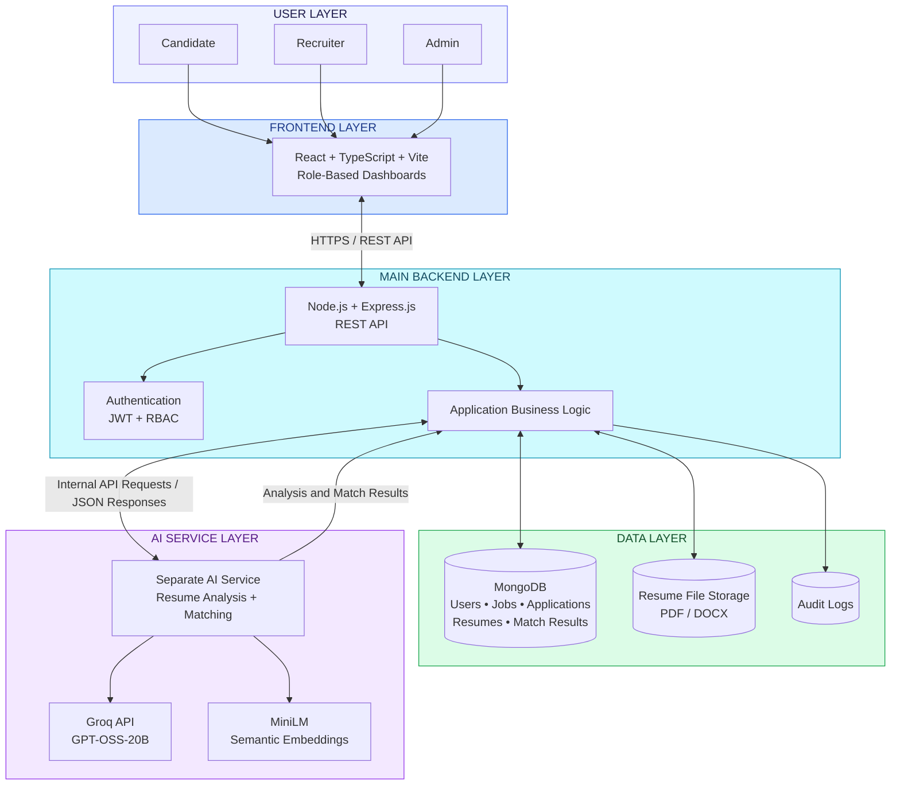
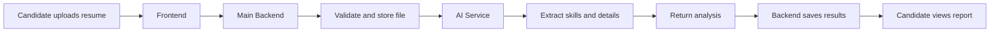
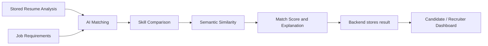
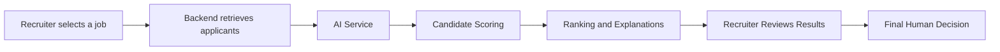
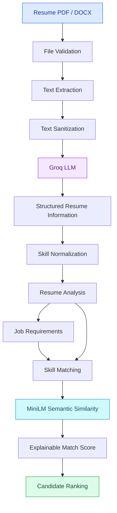

 <div align="center">

# 🚀 HireSmart AI

### AI-Based Resume Screening & Job Matching System


**An intelligent recruitment platform that connects candidates with suitable opportunities and helps recruiters make informed hiring decisions.**

[](https://react.dev/)
[](https://www.typescriptlang.org/)
[](https://nodejs.org/)
[](https://www.mongodb.com/)
[](https://groq.com/)

</div>

---

## 📌 1. Project Overview

**HireSmart AI** is an AI-powered recruitment platform designed to simplify and improve the hiring process.

The system helps candidates discover relevant job opportunities and allows recruiters to screen, evaluate, and manage applicants efficiently.

It uses Natural Language Processing (NLP), skill extraction, semantic similarity, and AI-based matching to analyse resumes and compare candidate profiles with job requirements.

The platform follows a **Human-in-the-Loop approach**, where AI provides recommendations and explanations while recruiters retain complete control over final hiring decisions.

## 🎯 2. Project Objectives

- Automate resume parsing and information extraction.
- Identify technical and professional skills from resumes.
- Match candidates with relevant job opportunities.
- Provide explainable candidate-job matching scores.
- Help recruiters screen and rank applicants efficiently.
- Support fair and responsible AI-assisted recruitment.
- Provide role-based dashboards for candidates, recruiters, and administrators.
- Maintain transparency and human oversight in hiring decisions.

## 👥 3. User Roles

| Role | Main Responsibilities |
|---|---|
| **Candidate** | Create profiles, upload resumes, view extracted skills, explore jobs, receive recommendations, and track applications. |
| **Recruiter** | Manage job postings, discover candidates, screen applicants, review match results, and manage hiring pipelines. |
| **Admin** | Manage users, complaints, skill taxonomy, audit logs, AI evaluation, and platform settings. |

## ✨ 4. Key Features

### 👨‍🎓 Candidate Module
- Candidate registration and authentication.
- Profile creation and management.
- Resume upload and analysis.
- Automatic skill extraction.
- Job discovery and search.
- AI-assisted job matching.
- Application tracking.
- Personalized recommendations.

### 🏢 Recruiter Module
- Recruiter profile management.
- Job creation and management.
- Candidate discovery.
- Resume screening and ranking.
- Match score explanations.
- Applicant management.
- Hiring pipeline management.
- Interview and application status tracking.

### 🛡️ Admin Module
- Admin dashboard.
- User management.
- Complaint management.
- Skill taxonomy management.
- Unknown skill review.
- Audit log monitoring.
- AI evaluation and system health monitoring.

### 🤖 AI Capabilities
- PDF and DOCX resume processing.
- Resume information extraction.
- Skill identification and normalization.
- Experience and education analysis.
- Semantic similarity using MiniLM embeddings.
- Candidate-job matching.
- Explainable matching results.
- Candidate ranking and screening.
- Initial prompt-injection detection and input sanitization.

## 🛠️ 5. Technology Stack

| Layer | Technologies |
|---|---|
| Frontend | React, TypeScript, Vite |
| Styling | Tailwind CSS |
| Animations | Framer Motion |
| Charts | Recharts |
| Backend | Node.js, Express.js, TypeScript |
| Database | MongoDB, Mongoose |
| Authentication | JWT, Role-Based Access Control |
| AI / LLM | Groq API – `openai/gpt-oss-20b` |
| Embeddings | Sentence Transformers – MiniLM |
| Resume Processing | PDF and DOCX parsing |
| Version Control | Git and GitHub |
| Containerization | Docker |
| CI/CD Preparation | Jenkins |
| Deployment Preparation | Kubernetes |

## 🏗️ 6. System Architecture

HireSmart AI follows a modular architecture with four main components:

1. **Frontend:** The interface used by candidates, recruiters, and administrators.
2. **Main Backend:** Handles authentication, business logic, database operations, and communication between services.
3. **AI Service:** Processes resumes and performs skill extraction, matching, semantic similarity, and candidate ranking.
4. **Database and File Storage:** Stores application data, uploaded resumes, analysis results, and audit records.

### 6.1 High-Level Architecture



### 6.2 How the Components Communicate

| Step | Component | Responsibility |
|---|---|---|
| 1 | User | Candidate, recruiter, or admin performs an action. |
| 2 | Frontend | Displays the interface and sends a request to the backend. |
| 3 | Main Backend | Validates the request, checks permissions, and handles application logic. |
| 4 | Database / File Storage | Stores or retrieves application data and uploaded resumes. |
| 5 | AI Service | Receives the required resume or job information from the backend. |
| 6 | AI Models | Groq extracts structured information; MiniLM supports semantic similarity. |
| 7 | Main Backend | Receives AI results and stores the relevant analysis or matching data. |
| 8 | Frontend | Displays the results to the appropriate user. |

**Important architectural principle:** The AI service does not directly manage user accounts, application roles, or the main MongoDB database. The main backend owns these responsibilities and communicates with the AI service.

### 6.3 Main Application Workflows

**A. Resume Upload and Analysis**



**B. Job Matching and Recommendations**



**C. Recruiter Screening**



## 🖥️ 7. Frontend Architecture

The frontend is developed using React, TypeScript, and Vite.

The application follows a component-based architecture with separate modules for candidates, recruiters, and administrators.

### Frontend Structure

```text
frontend/
│
├── src/
│   ├── components/
│   │
│   ├── pages/
│   │   ├── candidate/
│   │   ├── recruiter/
│   │   └── admin/
│   │
│   ├── services/
│   │
│   ├── hooks/
│   │
│   ├── contexts/
│   │
│   ├── types/
│   │
│   ├── utils/
│   │
│   └── App.tsx
│
├── public/
├── package.json
└── vite.config.ts
```

### Frontend Highlights

- Role-based navigation and dashboards.
- Reusable React components.
- Type-safe development using TypeScript.
- Responsive layouts for different screen sizes.
- Form validation and user feedback.
- Interactive charts and data visualization.
- Animations and transitions using Framer Motion.
- Centralized API service layer.
- Mock and live API modes.

### Mock and Live API Modes

The frontend supports two operating modes.

| Mode | Description |
|---|---|
| Mock Mode | Uses predefined mock data for frontend development and testing. |
| Live Mode | Connects to the backend through configured API endpoints. |

Configure the frontend environment:

```env
VITE_USE_MOCK=true
```

For backend integration:

```env
VITE_USE_MOCK=false
```

The live mode requires the corresponding backend APIs and services to be available.

## ⚙️ 8. Backend Requirements and Pending Integration

The main backend is responsible for managing application data, authentication, business logic, and communication with the AI service.

### Backend Responsibilities

- JWT authentication and role-based authorization.
- Candidate and recruiter profile management.
- Resume upload and file validation.
- Job creation, editing, and management.
- Application submission and tracking.
- Candidate screening and ranking.
- MongoDB persistence.
- AI service communication.
- Notifications and audit logging.

### Required Database Collections

| Collection | Purpose |
|---|---|
| Users | User accounts and roles |
| Candidate Profiles | Candidate information |
| Recruiter Profiles | Recruiter information |
| Resumes | Uploaded resumes and extracted analysis |
| Jobs | Job descriptions and requirements |
| Applications | Candidate applications and match results |
| Screening Settings | Recruiter weights and thresholds |
| Skills | Skill taxonomy and unknown skills |
| Notifications | User notifications |
| Audit Logs | Important system and AI events |

### Backend Integration Requirements

1. Verify MongoDB connectivity and persistent storage.
2. Complete and validate required API endpoints.
3. Integrate resume upload with the AI service.
4. Store extracted resume analysis.
5. Connect job requirements with matching functionality.
6. Store and retrieve candidate-job match results.
7. Implement screening and ranking APIs.
8. Add appropriate validation, error handling, and rate limiting.
9. Implement secure internal communication with the AI service.
10. Verify end-to-end workflows using real backend data.

## 🧠 9. AI Service Requirements and Integration

The AI service is designed as a separate service that communicates with the main backend.

### AI Technology

| Technology | Purpose |
|---|---|
| Groq API | Resume information extraction |
| `openai/gpt-oss-20b` | Structured AI-based extraction |
| MiniLM | Semantic similarity and embeddings |
| Skill Taxonomy | Skill normalization and categorization |

### AI Processing Workflow



### Matching Methodology

The initial matching approach uses the following weighted components:

| Component | Weight |
|---|---:|
| Skills | 50% |
| Experience | 20% |
| Education | 10% |
| Role Similarity | 20% |
| **Total** | **100%** |

Semantic similarity is incorporated into role similarity using MiniLM embeddings.

Initial screening categories:

- **Strong Match:** 80% and above.
- **Potential Match:** 60% and above.
- **Low Match:** Below 60%.

These are initial heuristic thresholds and require further evaluation before being treated as validated hiring criteria.

### AI Integration Requirements

- Expose AI functionality through a dedicated API.
- Integrate the AI service with the main backend.
- Implement secure service-to-service authentication.
- Add structured API responses and error codes.
- Implement rate limiting and request handling.
- Add caching to avoid unnecessary repeated resume analysis.
- Store AI analysis and matching results through the backend.
- Implement fairness, stability, and security evaluation.
- Add audit-event reporting.
- Validate AI outputs with real-world test cases.

## 📊 10. AI API Endpoints

The following endpoints represent the planned AI service interface and require implementation and integration verification.

| Endpoint | Purpose |
|---|---|
| `GET /health` | Check AI service availability |
| `POST /resume/analyze` | Analyse and extract resume information |
| `POST /match` | Match a candidate with a job |
| `POST /screen` | Rank candidates for a job |
| `POST /recommend` | Recommend suitable jobs |
| `POST /skill-gap` | Identify missing skills |
| `POST /jobs/extract` | Extract structured job requirements |
| `POST /evaluation/run` | Run AI evaluation tests |

The main backend should communicate with these endpoints and handle persistence, authentication, and audit logging.

## ✅ 11. Frontend Development Completed

The frontend has gone through multiple development and verification phases.

| Phase | Work Completed |
|---|---|
| Phase 1 | Frontend functional audit and issue fixes |
| Phase 2 | UI improvements and responsive design |
| Phase 3 | API integration preparation |
| Phase 4 | AI and backend integration readiness |
| Phase 5 | Backend integration review and frontend service preparation |
| Phase 6F | Frontend workflow verification and responsive design audit |

### Completed Frontend Work

- Public pages and role-based dashboards.
- Candidate workflows and profile management.
- Recruiter workflows and hiring pipeline.
- Admin dashboard and management pages.
- Navigation and protected routes.
- Form validation and interactive controls.
- Mock API functionality.
- API service and TypeScript interface preparation.
- Responsive layouts for desktop, tablet, and mobile.
- Loading, error, and empty-state handling.
- Automated build, lint, and test verification.

**Verification note:** The reported automated checks passed, including the final 110/110 test count. These results do not replace manual browser testing or verification against a live backend.

## 🚧 12. Current Pending Work

### Frontend

- Connect all relevant services to verified live backend APIs.
- Integrate real AI analysis and matching responses.
- Display complete resume analysis reports.
- Add candidate skill-gap and job recommendation results.
- Add recruiter screening weights and threshold controls where required.
- Display matched, partial, and missing skills.
- Add clear explanations for candidate matching scores.
- Add unknown-skill review and real AI evaluation data to admin pages.
- Perform manual browser and device testing.

### Backend

- Verify persistent MongoDB integration.
- Complete and test all required API endpoints.
- Connect resume upload to the AI service.
- Store resume analysis and matching results.
- Implement screening settings and ranking persistence.
- Integrate audit events and security handling.
- Verify authentication and authorization across all roles.

### AI Service

- Implement the remaining AI API endpoints.
- Add resume analysis reports and insights.
- Implement skill-gap analysis.
- Implement job recommendations.
- Add job description requirement extraction.
- Implement blind-screening support.
- Add fairness and bias evaluation.
- Add extraction accuracy and stability tests.
- Add audit-event payloads and unknown-skill review.
- Complete Docker and backend integration.

### Testing and Deployment

- End-to-end testing across all three user roles.
- Real MongoDB integration testing.
- AI service integration testing.
- Security and authorization testing.
- Fairness and responsible AI evaluation.
- Docker Compose integration.
- Jenkins CI/CD pipeline verification.
- Kubernetes deployment preparation.
- Final documentation and project demonstration.

## 🔐 13. Security and Responsible AI

HireSmart AI is designed with security, transparency, and responsible AI principles in mind.

- JWT-based authentication.
- Role-Based Access Control (RBAC).
- Secure resume upload validation.
- Input sanitization and prompt-injection detection.
- Secure handling of API credentials.
- Protection of candidate information.
- Explainable AI matching results.
- Human review of AI-generated recommendations.
- Fairness and bias evaluation.
- Audit logging for important operations.

**Important:** AI-generated scores are decision-support information, not final hiring decisions. Recruiters remain responsible for reviewing candidates and making hiring decisions.

Resume content sent to third-party AI providers must be handled transparently, with appropriate privacy safeguards and data minimization.

## ▶️ 14. Running the Project

### Prerequisites

- Node.js
- npm
- MongoDB
- Git

### Clone the Repository

```bash
git clone https://github.com/tharunsai01/ResumeAI.git
cd ResumeAI
```

### Run the Frontend

```bash
cd frontend
npm install
npm run dev
```

The Vite development server will display the local URL in the terminal.

### Run the Main Backend

```bash
cd server
npm install
```

Configure the required environment variables before starting the backend.

Use the scripts defined in the backend `package.json` to run the server.

### Environment Configuration

Example frontend configuration:

```env
VITE_USE_MOCK=true
```

Example backend configuration:

```env
PORT=5000
MONGODB_URI=your_mongodb_connection_string
JWT_SECRET=your_jwt_secret
AI_SERVICE_URL=your_ai_service_url
AI_SERVICE_API_KEY=your_internal_service_key
```

Example AI service configuration:

```env
GROQ_API_KEY=your_groq_api_key
```

**Security:** Never commit real API keys, database credentials, or secret environment files to GitHub. Use environment variables and provide safe example values in `.env.example`.

## 🧪 15. Testing

The project uses automated checks to validate frontend functionality and code quality.

| Testing Area | Purpose |
|---|---|
| Functional Testing | Verify application workflows |
| Unit Testing | Test individual components and functions |
| Responsive Testing | Check layouts across screen sizes |
| API Testing | Verify frontend-backend communication |
| Integration Testing | Validate communication between services |
| AI Evaluation | Measure extraction, matching, fairness, and stability |
| Security Testing | Validate authentication, authorization, and input handling |

Frontend automated verification has been reported as successful. Live backend, database, and complete AI integration still require end-to-end validation.

## 🗺️ 16. Future Roadmap

- Complete backend and AI service integration.
- Improve resume analysis and candidate insights.
- Introduce advanced job recommendations.
- Improve fairness and bias evaluation.
- Expand the skill taxonomy.
- Complete recruiter screening controls.
- Strengthen security and privacy safeguards.
- Complete automated deployment pipelines.
- Perform final system testing and deployment.

## 👨‍💻 17. Repository Information

**Project:** HireSmart AI  
**Repository:** [tharunsai01/ResumeAI](https://github.com/tharunsai01/ResumeAI)  
**Project Type:** AI-Based Resume Screening and Job Matching System  
**Architecture:** React Frontend + Express Backend + MongoDB + Separate AI Service

---

<div align="center">

### 💡 Hire Smarter. Match Better. Build Fairer.

**HireSmart AI — AI-assisted recruitment with human decision-making.**

</div>