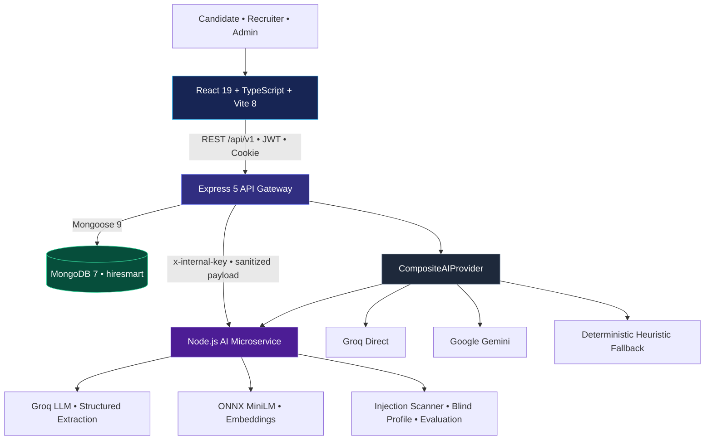
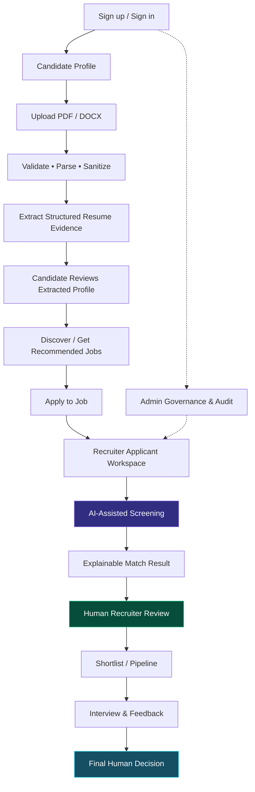

<div align="center">
  
  <br/>
  <a href="https://github.com/tharunsai01/ResumeAI"></a>
  <br/><br/>
  
  
  
  
  
  
  <br/><br/>
  <a href="#-project-overview">Overview</a> • <a href="#-architecture">Architecture</a> • <a href="#-workflows">Workflows</a> • <a href="#-ai-engine">AI Engine</a> • <a href="#-security">Security</a> • <a href="#-setup">Setup</a>
</div>

<div align="center">
  <h3>Recruitment, redesigned around evidence.</h3>
  <p>HireSmart AI is a full-stack recruitment platform that transforms resumes and job descriptions into structured, explainable hiring insights—while keeping every final hiring decision with people.</p>
</div>

---

## ✦ Project Overview

HireSmart AI bridges high-volume hiring and transparent candidate evaluation. It is designed as a **human-in-the-loop decision-support system**, not an automated rejection engine. The platform combines structured PDF/DOCX resume extraction, evidence-backed skill analysis, hybrid semantic and rule-based matching, job discovery, application tracking, recruiter workflows, and administrative governance.

| Candidate experience | Recruiter experience | Administrator experience |
|:--|:--|:--|
| Upload and analyze resumes, inspect skill gaps, discover jobs, apply, and track application timelines. | Publish jobs, extract requirements, screen applicants individually or in bulk, review blind profiles, manage the hiring pipeline, and schedule interviews. | Govern platform health, moderate users and jobs, resolve complaints, curate skills, inspect audit logs, and review AI evaluations. |

**Core principle:** AI can organize evidence and explain relevance. It does not make the final employment decision.

## ✦ Objectives

- **Structured extraction:** Convert PDF/DOCX resumes and pasted job descriptions into normalized, schema-validated data.
- **Transparent matching:** Use an explainable 50/20/10/20 model instead of opaque ranking.
- **Human authority:** Keep AI advisory; never automatically reject a candidate.
- **Adversarial resilience:** Detect prompt injection, invisible Unicode, keyword stuffing, and spoofed file extensions.
- **Fairness and privacy:** Sanitize PII before external inference and support blind candidate profiles.
- **Operational visibility:** Provide sanitized audit logs, health diagnostics, and automated verification across services.

## ✦ Architecture

HireSmart AI uses a **gateway-centred three-service architecture**. The Express backend is the central authority for authentication, authorization, persistence, and orchestration. The browser never calls the internal AI microservice directly.

<div align="center">
  
</div>



| Service | Runtime / port | Responsibility |
|:--|:--|:--|
| Frontend | React + Vite / 5173 | Role-specific interfaces, navigation, forms, dashboards, charts, and API clients |
| Backend | Express + TypeScript / 5000 | API gateway, authentication, RBAC, validation, business logic, persistence, and provider orchestration |
| AI service | Express + Node.js / 8000 | Resume and job extraction, injection scanning, semantic embeddings, matching, blind profiles, and evaluation |
| Database | MongoDB / 27017 | 17 Mongoose models for identity, profiles, jobs, applications, interviews, notifications, governance, and evaluation |

### Resilient four-tier AI provider chain

The backend `CompositeAIProvider` routes AI operations through ordered providers:

1. **HttpAiMicroserviceProvider** — dedicated AI service endpoints, configured through `AI_SERVICE_URL` and `AI_SERVICE_KEY`.
2. **GroqDirectProvider** — direct Groq JSON chat completion using the configured `GROQ_API_KEY`.
3. **GeminiProvider** — Google Gemini JSON-generation fallback using `GEMINI_API_KEY`.
4. **HeuristicRuleBasedProvider** — deterministic in-process matching when external providers are unavailable.

This layered design helps preserve core matching workflows when an external provider or the AI microservice cannot be reached. Provider-specific extraction still requires valid credentials and model availability.

## ✦ Technology Stack

<div align="center">
  
</div>

| Layer | Technologies |
|:--|:--|
| **Frontend** | React 19, TypeScript, Vite 8, Tailwind CSS 4, React Router DOM 7, Framer Motion 13, Recharts 3, Lucide React, OGL |
| **Backend** | Node.js, Express 5, TypeScript, Mongoose 9, Zod 4, JWT, bcryptjs, Google Auth Library, Multer, pdf-parse, Mammoth, Nodemailer, Helmet, express-rate-limit |
| **AI service** | Node.js ESM, Express 5, Groq SDK, Hugging Face Transformers.js, ONNX Runtime, PDF.js, Mammoth, Zod |
| **AI models** | `openai/gpt-oss-20b` (configured Groq model), `onnx-community/all-MiniLM-L6-v2-ONNX` |
| **Database** | MongoDB 7+ with 17 Mongoose models |
| **Testing** | TypeScript integration/E2E suites, Playwright Chromium, Python Selenium smoke test, AI service phase 1–8 scripts |
| **Infrastructure** | Docker, Docker Compose, Nginx, TLS overlay, Kubernetes manifests, Jenkins, shell CI scripts |

## ✦ Core Features

<details open>
<summary><strong>01 · Identity, Authentication & Access</strong></summary>

- Candidate, recruiter, and admin role-isolated portals.
- Email/password authentication with bcrypt password hashing.
- JWT access tokens and rotating HTTP-only refresh-cookie sessions.
- Google OAuth 2.0 popup and authorization-code callback flows.
- OAuth state validation, account/profile provisioning, and admin privilege-escalation protection.
- Frontend protected routes and backend authentication/authorization middleware.
</details>

<details>
<summary><strong>02 · Resume Intelligence & Candidate Insights</strong></summary>

- PDF and DOCX resume uploads with file-signature validation.
- Resume text extraction, normalization, and structured LLM extraction.
- Skill, education, experience, project, and role evidence analysis.
- Resume quality scoring and review-before-save profile updates.
- Skill-gap analysis, proficiency levels, market-demand insights, and career-path comparisons.
- SHA-256 resume fingerprinting and duplicate detection.
</details>

<details>
<summary><strong>03 · Job Discovery & Job Intelligence</strong></summary>

- Recruiter job creation, editing, publishing, and closing.
- Structured job requirement extraction from pasted job descriptions.
- Required/preferred skills, experience ranges, and education expectations.
- Candidate job search, filters, bookmarks, and personalized recommendations.
</details>

<details>
<summary><strong>04 · AI Screening & Talent Matching</strong></summary>

- Single-candidate and bulk screening.
- Weighted skills, experience, education, and role-similarity scoring.
- Local ONNX semantic embeddings combined with deterministic rules.
- Blind-screened candidate profiles.
- Persistent match results with score breakdowns, strengths, gaps, and suggestions.
- Recruiter-controlled thresholds and review.
</details>

<details>
<summary><strong>05 · Hiring Pipeline & Interviews</strong></summary>

- Kanban-style applicant lifecycle: Applied → Screened → Shortlisted → Interview → Hired / Rejected.
- Recruiter notes and stage history.
- Interview scheduling, external meeting links, feedback, and ratings.
- In-app notifications and application timeline visibility.
</details>

<details>
<summary><strong>06 · Administration & Governance</strong></summary>

- Platform metrics and system-health monitoring.
- User and job moderation; suspended accounts lose protected API access.
- Complaint submission, triage, and resolution notes.
- Skill taxonomy maintenance and unknown-skill review.
- Audit-log search and pagination.
- AI fairness, stability, extraction, and security evaluation views.
</details>

## ✦ Workflows

### End-to-end recruitment lifecycle



### Workflow at a glance

| Stage | Candidate | Recruiter | Platform |
|:--|:--|:--|:--|
| Onboarding | Register / sign in | Register / sign in | Authenticate and authorize |
| Preparation | Profile and resume | Organization and job setup | Validate and persist records |
| Discovery | Search and recommendations | Talent pool and applicants | Index/filter relevant data |
| Evaluation | Review skills and job fit | Run screening and inspect evidence | Extract, score, explain, audit |
| Selection | Track application | Shortlist and manage pipeline | Persist stage history |
| Interview | View schedule and status | Schedule and record feedback | Notify relevant users |
| Governance | Raise support issue | Raise support issue | Admin moderation and audit |

## ✦ Dashboard Workflows

<details>
<summary><strong>Candidate Dashboard · Routes & capabilities</strong></summary>

| Page / route | What the candidate can do |
|:--|:--|
| `/candidate/dashboard` | Review application counts, shortlisted/interview metrics, profile completion, and recent statuses |
| `/candidate/resume` | Upload PDF/DOCX, switch active resume, download files, and inspect security status |
| `/candidate/resume/analysis` | Review resume quality, strengths, weaknesses, and extracted profile data before saving |
| `/candidate/jobs` | Search and filter by keyword, category, experience, and work mode |
| `/candidate/jobs/:jobId` | Inspect job details, run a pre-application fit check, and apply |
| `/candidate/recommended` | Explore personalized job recommendations |
| `/candidate/applications` | Track application statuses |
| `/candidate/applications/:applicationId` | View status history and interview details |
| `/candidate/skills` | Inspect competency charts, proficiency, demand, missing skills, and career paths |
| `/candidate/profile` | Manage personal, education, experience, skill, and link information |
| `/candidate/profile/preview` | Preview the candidate profile |
| `/candidate/settings` | Manage settings and preferences |
| `/candidate/complaint` · `/candidate/help` | Submit support requests and access help |
</details>

<details>
<summary><strong>Recruiter Dashboard · Routes & capabilities</strong></summary>

| Page / route | What the recruiter can do |
|:--|:--|
| `/recruiter/dashboard` | Review active jobs, applicants, screened candidates, and interviews |
| `/recruiter/jobs` | View and manage job postings |
| `/recruiter/jobs/create` | Create a job with structured requirements |
| `/recruiter/jobs/:jobId` | Inspect a job and applicant statistics |
| `/recruiter/jobs/:jobId/edit` | Update job information |
| `/recruiter/candidates` | Search and filter the talent pool |
| `/recruiter/candidates/:candidateId` | Inspect candidate information |
| `/recruiter/screening` | Open the AI screening hub |
| `/recruiter/screening/:jobId` | Run single/bulk screening and review ranked candidates |
| `/recruiter/screening/:jobId/:candidateId` | Inspect an individual match explanation |
| `/recruiter/shortlist` · `/recruiter/hiring` | Manage shortlisted applicants and hiring stages |
| `/recruiter/interviews` | Schedule and manage interviews |
| `/recruiter/interviews/:interviewId` | Record feedback, ratings, and outcomes |
| `/recruiter/analytics` | Inspect recruitment funnel metrics |
</details>

<details>
<summary><strong>Admin Dashboard · Routes & capabilities</strong></summary>

| Page / route | What the administrator can do |
|:--|:--|
| `/admin` | Review platform-wide users, jobs, applications, resumes, and trends |
| `/admin/users` · `/admin/users/:userId` | Search, inspect, suspend, and reactivate users |
| `/admin/complaints` · `/admin/complaints/:complaintId` | Triage complaints and record resolution notes |
| `/admin/skills` | Manage taxonomy and review unknown skills |
| `/admin/audit-logs` | Search and paginate audit events |
| `/admin/ai-evaluation` | Review AI fairness, stability, extraction, and security evaluation records |
| `/admin/system-health` | Inspect API, MongoDB, AI service, latency, memory, and uptime information |
</details>

## ✦ AI Engine

### Explainable weighted matching

The matching engine uses a calibrated weighted formula:

<div align="center">
  <h2>50% · 20% · 10% · 20%</h2>
  <p><strong>Skills · Experience · Education · Role Similarity</strong></p>
</div>

```text
Overall Match =
  (Skills Match      × 0.50) +
  (Experience Match  × 0.20) +
  (Education Match   × 0.10) +
  (Role Similarity   × 0.20)
```

| Dimension | Weight | Evaluation focus |
|:--|:--:|:--|
| Skills | **50%** | Required and preferred skill evidence |
| Experience | **20%** | Dated role history and required experience range |
| Education | **10%** | Degree/education requirement alignment |
| Role similarity | **20%** | Semantic and rule-based role relevance |

### Evidence-based skill scoring

Skill scores are based on evidence, not only keyword frequency:

| Evidence | Contribution |
|:--|--:|
| Skill mentioned | +30 |
| Listed in skills section | +10 |
| Used per experience role | +12, capped at 25 |
| Used per project | +10, capped at 20 |
| Years in roles using the skill | +5/year, capped at 15 |

Additional anti-inflation controls:

- Required skills contribute **80%** of the skill score; preferred skills contribute **20%**.
- Partial matches receive **0.5** credit.
- Listed-only skills above the configured cap of **12** are down-weighted to reduce keyword stuffing.
- When dated roles exist, effective experience uses the lower of stated and computed years.
- Overlapping employment periods are not double-counted.

### Hybrid semantic role similarity

Role relevance combines local ONNX MiniLM semantic similarity (**60%**) with rule-based role similarity (**40%**). Cosine similarity is calibrated from the configured range `[0.2, 0.7]` into a 0–100 score.

### Screening bands

| Classification | Default score |
|:--|:--:|
| **Strong Match** | ≥ 80 |
| **Potential Match** | ≥ 60 and < 80 |
| **Low Match** | < 60 |

Thresholds and matching weights are configurable. A score is a relevance signal—not a probability of job success.

## ✦ Security

Security is implemented across identity, API access, file ingestion, AI inference, and auditability.

| Security layer | Implementation |
|:--|:--|
| Password protection | bcryptjs password hashing |
| Session security | Short-lived JWT access token; HTTP-only refresh cookie; SHA-256 hashed refresh-token storage and rotation |
| RBAC | Backend `authenticate` and `authorize(...roles)`; account status checked on protected requests |
| OAuth | Google OAuth 2.0 state validation and protection against admin privilege escalation |
| Internal service auth | `x-internal-key` required for AI service requests; constant-time `crypto.timingSafeEqual` comparison |
| File verification | PDF/DOCX magic-byte validation; extension/content mismatch rejection; UUID-based storage names |
| Upload limits | Backend upload cap 10 MB; AI parser cap 5 MB |
| PII protection | `sanitizePii()` masks emails, phone numbers, and URLs before outbound AI calls |
| Prompt-injection defence | Pattern scanner, suspicious-line redaction, and security findings |
| HTTP hardening | Helmet, strict CORS allowlists, disabled `X-Powered-By`, CSP for API docs, and rate limiting |
| Data governance | Sanitized audit events and role-isolated access |

### Prompt-injection defence

The AI service checks for eight instruction-pattern categories plus invisible/zero-width character anomalies:

`override-instructions` · `role-hijack` · `system-prompt-reference` · `score-manipulation` · `hire-directive` · `chat-markup` · `output-directive` · `concealment`

Flagged lines are replaced with `[REMOVED: instruction-like content]` before LLM inference. Suspicious content is surfaced for review rather than silently treating the resume as invalid.

### Blind screening & privacy

The blind-profile workflow pseudonymizes candidates (for example, `Candidate XXXX`) and redacts selected identifiers such as names, contacts, locations, company names, institution names, and—by default—education dates. Scoring itself uses job-related evidence rather than direct identifiers. Free-text can still contain identifying clues, so blind screening reduces exposure but does not guarantee anonymity.

## ✦ AI Decision Principles

1. **Human authority:** AI screening produces evidence and recommendations; it does not automatically reject candidates or make the final hiring decision.
2. **Explainability:** Results include component scores, matched/missing skills, strengths, and gaps—not just a single percentage.
3. **Deterministic stability:** Configured model settings and deterministic scoring rules reduce avoidable run-to-run variation.
4. **Job-related evaluation:** Matching focuses on skills, experience, education, and role relevance rather than direct personal identifiers.
5. **Privacy by design:** Selected PII is sanitized before external AI calls; blind profiles reduce exposure during review.
6. **Adversarial resilience:** Suspicious resume instructions are flagged and sanitized, with security findings available for oversight.
7. **Reviewable governance:** Evaluation utilities support fairness, stability, extraction, and security testing; these measurements do not alone prove legal compliance or absence of bias.

## ✦ Key Innovations

- **Evidence-weighted skill intelligence:** Distinguishes demonstrated skills in roles and projects from unsupported keyword lists.
- **Local ONNX semantic matching:** Combines MiniLM embeddings with deterministic rules without requiring an external embedding API.
- **Four-tier AI orchestration:** Falls back from the AI microservice to direct Groq, Gemini, and deterministic in-process matching.
- **Adversarial resume defence:** Scans prompt injection, removes suspicious instructions from model input, and records findings.
- **Blind candidate review:** Pseudonymized profiles help reduce exposure to direct identifiers.
- **Built-in AI evaluation toolkit:** Supports counterfactual fairness variants, score stability, injection attack testing, and blind-profile leakage checks.
- **Explicit profile consent flow:** Extracted resume fields require candidate review before overwriting profile data.
- **Live-mode isolation:** New candidate accounts begin with clean profiles; logout clears client-side user data.

## ✦ Data Management & Auditability

The `hiresmart` MongoDB database uses 17 Mongoose models:

| Domain | Models |
|:--|:--|
| Identity & authentication | `User`, `RefreshToken`, `AuthToken` |
| Profiles & talent | `CandidateProfile`, `RecruiterProfile`, `Resume`, `Skill` |
| Hiring workflow | `Job`, `Application`, `MatchResult`, `Shortlist`, `Interview`, `ScreeningSettings` |
| Governance & communication | `Notification`, `Complaint`, `AuditLog`, `AIEvaluation` |

**Audit controls**
- Backend audit records cover authentication, resumes, AI screening, moderation, skills, and evaluation events.
- Sensitive keys such as passwords, tokens, secrets, and raw resume text are scrubbed from audit payloads.
- AI audit events include `RESUME_ANALYZED`, `MATCH_SCORED`, `SCREENING_RUN`, `JOB_EXTRACTED`, `INJECTION_DETECTED`, and `EVALUATION_RUN`.
- Opaque references and request IDs support event correlation without copying raw resume content into AI audit details.
- Resume SHA-256 fingerprints and unique candidate/job application constraints help prevent duplicates.

## ✦ Project Structure

```text
ResumeAI/
├── frontend/
│   ├── src/
│   │   ├── components/       # Shared UI, auth, protected routes, layouts
│   │   ├── config/           # Frontend environment configuration
│   │   ├── context/          # Authentication and domain contexts
│   │   ├── data/             # Offline mock datasets
│   │   ├── hooks/            # Reusable React hooks
│   │   ├── pages/            # Public, candidate, recruiter, admin views
│   │   ├── services/         # API clients and HTTP client
│   │   └── types/            # TypeScript domain interfaces
│   └── tests/                # Playwright and Selenium browser tests
├── backend/
│   ├── docs/                 # OpenAPI specification and Swagger assets
│   ├── src/
│   │   ├── config/           # Database and environment configuration
│   │   ├── controllers/      # REST request handlers
│   │   ├── middleware/       # Authentication, authorization, validation
│   │   ├── models/           # 17 Mongoose models
│   │   ├── routes/           # Versioned /api/v1 routes
│   │   ├── seed/             # Development database seed
│   │   ├── services/         # Business logic and AI provider orchestration
│   │   ├── utils/            # API, token, and file helpers
│   │   └── validators/       # Zod validation schemas
│   ├── tests/                # Integration and end-to-end suites
│   └── uploads/resumes/      # Local resume storage
├── ai-service/
│   ├── scripts/              # Phase 1–8 tests and model download
│   ├── samples/              # Sample resumes and fixtures
│   ├── src/
│   │   ├── audit/            # PII-free AI audit events
│   │   ├── blind/            # Pseudonymization and redaction
│   │   ├── evaluation/       # Fairness, stability, security tests
│   │   ├── extraction/       # Resume LLM extraction and schemas
│   │   ├── jobs/              # Job description extraction
│   │   ├── matching/          # Weighted scoring and parsers
│   │   ├── parsing/           # PDF/DOCX extraction and cleaning
│   │   ├── recommend/         # Job recommendation logic
│   │   ├── security/          # Prompt-injection scanner
│   │   ├── semantic/          # ONNX embeddings and cosine scoring
│   │   ├── server/            # Express app and internal-key auth
│   │   ├── skillgap/          # Skill-gap and career-path analysis
│   │   └── taxonomy/          # Skill aliases and normalization
│   └── API.md
├── deploy/
│   ├── kubernetes/            # Kubernetes manifests
│   └── nginx/                 # HTTPS reverse-proxy configuration
├── docs/                      # Architecture, API, test report, Postman
├── scripts/                   # CI scripts
├── docker-compose.yml
├── docker-compose.https.yml
├── Jenkinsfile
└── .env.example
```

## ✦ Setup

### Prerequisites

- Node.js 20+ (AI service requires Node.js 18+).
- MongoDB 7+.
- npm.
- Python 3 only if running the optional Selenium smoke test.

### 1 · Clone the repository

```bash
git clone https://github.com/tharunsai01/ResumeAI.git
cd ResumeAI
```

### 2 · Install dependencies

```bash
cd backend && npm install
cd ../ai-service && npm install
cd ../frontend && npm install
```

### 3 · Configure environment files

Create local environment files using the repository templates:

- `backend/.env.example` → `backend/.env`
- `ai-service/.env.example` → `ai-service/.env`
- `frontend/.env.example` → `frontend/.env`
- Root `.env.example` → root `.env` for Docker Compose

### 4 · Seed development data (optional)

```bash
cd backend
npm run seed
```

The seed script refuses to run when `NODE_ENV=production`.

### 5 · Start the services

Run each service in its own terminal:

```bash
# Terminal 1 — AI service
cd ai-service
npm start

# Terminal 2 — Backend API
cd backend
npm run dev

# Terminal 3 — Frontend
cd frontend
npm run dev
```

Open the frontend at [http://localhost:5173](http://localhost:5173).

### 6 · Verify service health

```bash
curl http://localhost:8000/health
curl http://localhost:5000/health
curl http://localhost:5000/api/v1/health
```

## ✦ Environment Configuration

<details>
<summary><strong>Backend · backend/.env</strong></summary>

```env
NODE_ENV=development
PORT=5000
MONGODB_URI=mongodb://127.0.0.1:27017/hiresmart
CLIENT_URL=http://localhost:5173
JWT_ACCESS_SECRET=replace_with_a_random_secret_at_least_32_chars
JWT_ACCESS_MINUTES=15
JWT_REFRESH_DAYS=7
AI_SERVICE_URL=http://127.0.0.1:8000
AI_SERVICE_KEY=replace_with_a_random_secret_at_least_16_chars
GROQ_API_KEY=
GEMINI_API_KEY=
OPENAI_API_KEY=
GOOGLE_CLIENT_ID=
GOOGLE_CLIENT_SECRET=
GOOGLE_REDIRECT_URI=http://localhost:5173/oauth/callback
SMTP_HOST=
SMTP_PORT=587
SMTP_USER=
SMTP_PASS=
EMAIL_FROM=HireSmart AI <no-reply@hiresmart.local>
```
</details>

<details>
<summary><strong>AI Service · ai-service/.env</strong></summary>

```env
PORT=8000
AI_SERVICE_KEY=must_match_backend_and_be_at_least_16_chars
GROQ_API_KEY=your_groq_api_key
GROQ_MODEL=openai/gpt-oss-20b
ALLOW_TXT_UPLOADS=false
# Optional: MAX_CONCURRENT_LLM=2
# Optional: MAX_LLM_QUEUE=50
# Optional embedding overrides: EMBEDDING_MODEL, EMBEDDING_DTYPE, EMBEDDING_CACHE_DIR
```
</details>

<details>
<summary><strong>Frontend · frontend/.env</strong></summary>

```env
VITE_API_BASE_URL=http://localhost:5000/api/v1
VITE_USE_MOCK=false
VITE_GOOGLE_CLIENT_ID=
```
</details>

> **Security note:** Never commit real API keys, OAuth secrets, SMTP credentials, database passwords, or JWT secrets. Variables prefixed with `VITE_` are bundled for browser access and must never contain private credentials.

## ✦ Docker Deployment

The root Compose stack orchestrates MongoDB, the AI service, backend API, and frontend. The frontend container serves the Vite build through Nginx and proxies API traffic to the backend.

```bash
# Prepare root environment
cp .env.example .env
# Set AI_SERVICE_KEY and provider credentials in .env

# Build and start
docker compose up --build -d --wait

# Inspect services
docker compose ps

# Verify frontend proxy -> backend
curl --fail http://localhost:5173/api/v1/health
```

Optional HTTPS overlay (TLS terminates on port `35443`):

```bash
TLS_DIRECTORY=/path/to/certs docker compose -f docker-compose.yml -f docker-compose.https.yml up -d
```

Kubernetes manifests are located in `deploy/kubernetes/`. Nginx TLS configuration is in `deploy/nginx/https.conf`.

## ✦ Testing & Verification

### Production builds

```bash
npm --prefix backend run build
npm --prefix frontend run build
```

### Backend · 104 automated tests

```bash
cd backend
npm run test
npm run test:e2e
npm run test:all
```

### AI service · phase 1–8 verification

```bash
cd ai-service
npm run test:phase1
for phase in 2 3 4 5 6 7 8; do npm run "test:phase${phase}:offline"; done
```

### Browser automation · Playwright

```bash
cd frontend
npx playwright install chromium
npm run test:browser
```

Optional Selenium smoke test:

```bash
python -m venv .venv
.venv/bin/python -m pip install selenium
RESUMEAI_BASE_URL=http://localhost:5173 .venv/bin/python frontend/tests/selenium_smoke.py
```

### Recorded verification

The supplied project documentation records successful frontend and backend production builds, **104/104 backend integration and workflow tests**, and a passing Playwright landing-page check. The detailed test history and endpoint matrix are in [docs/FULL_STACK_TEST_REPORT.md](docs/FULL_STACK_TEST_REPORT.md). Re-run the suites against the current commit and environment before relying on those results for a release.

## ✦ API & Technical Documentation

| Resource | Description |
|:--|:--|
| [Swagger UI](http://localhost:5000/api/docs) | Interactive backend API documentation when the backend is running |
| [Backend route index](http://localhost:5000/api/v1) | Live JSON index of mounted API resources |
| [AI Service API](ai-service/API.md) | Internal microservice API contract |
| [Architecture](docs/architecture.md) | Architecture notes |
| [API summary](docs/api.md) | Endpoint summary |
| [Full-stack test report](docs/FULL_STACK_TEST_REPORT.md) | Verification history and endpoint matrix |
| [Postman collection](docs/ResumeAI.postman_collection.json) | Importable API collection |

## ✦ Known Limitations & Future Scope

| Current limitation | Planned direction |
|:--|:--|
| Admin evaluation endpoint currently records deterministic benchmark metrics instead of orchestrating the AI service evaluation runner. | Connect the admin evaluation API to `POST /v1/evaluation/run` with progress tracking. |
| AI microservice screening does not score non-empty cover letters; the provider chain falls back to another provider. | Align cover-letter support across providers. |
| Resume files use local disk or Docker volume storage. | Add S3, GCS, or Cloudflare R2 with pre-signed URLs and lifecycle policies. |
| Without SMTP configuration, development verification/reset links are logged rather than emailed. | Configure a transactional email provider such as SES, SendGrid, or Resend. |
| Interviews store external meeting URLs; native video calling is not included. | Add WebRTC and calendar synchronization. |
| Legacy backend LinkedIn routes remain although frontend LinkedIn sign-in flows were removed. | Remove unused routes and keep auth surfaces consistent. |
| `next-app/` is an unintegrated Next.js starter scaffold. | Integrate intentionally or remove the unused scaffold. |
| CI script invokes a backend `test:unit` command not currently declared in the backend package scripts. | Align CI commands with the actual package scripts. |

## ✦ Responsible Use

HireSmart AI is a recruitment decision-support tool. AI scores may be incomplete, sensitive to resume quality, or unsuitable for a particular role. Recruiters must review underlying evidence, apply consistent job-related criteria, and retain responsibility for every employment decision. Fairness and security evaluation utilities support governance but do not, by themselves, establish that a system is unbiased or legally compliant.

---

<div align="center">
  
  <h3>Built for smarter hiring. Designed for human decisions.</h3>
  <sub>HireSmart AI · Resume Intelligence · Explainable Matching · Responsible Recruitment</sub>
  <br/><br/>
  <a href="#hiresmart-ai">Back to top ↑</a>
</div>
