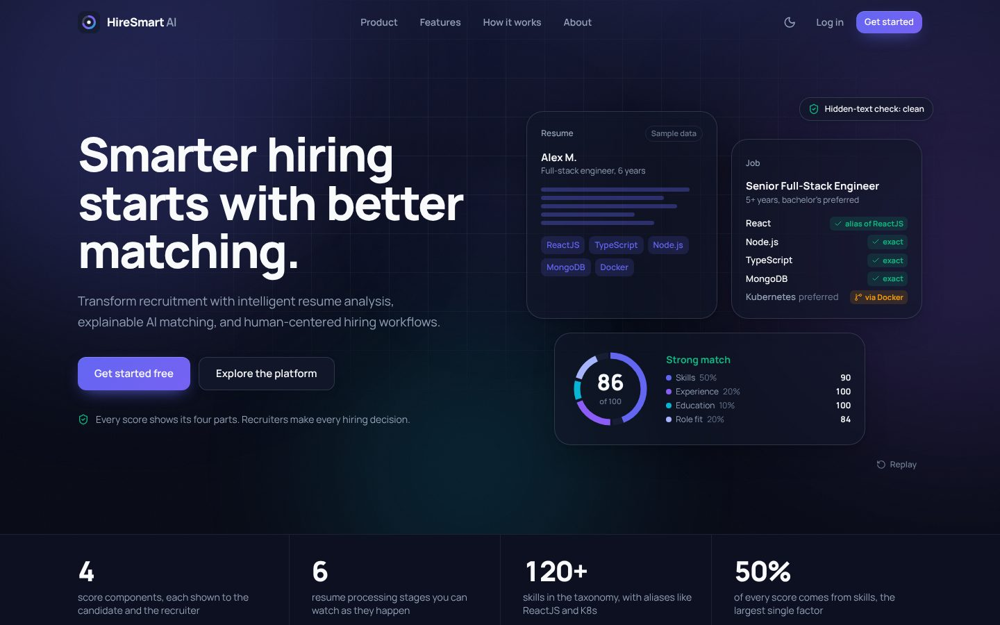
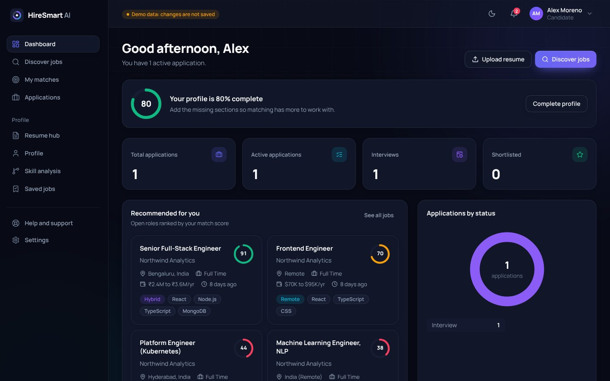
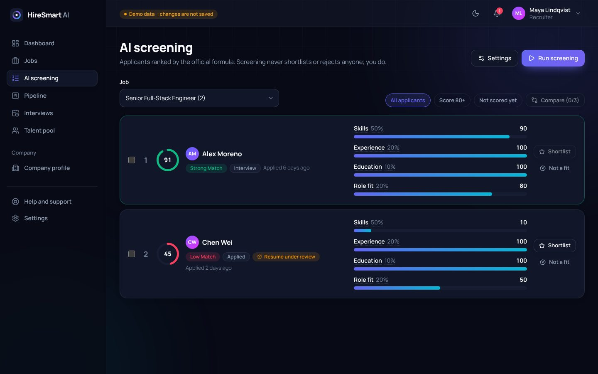
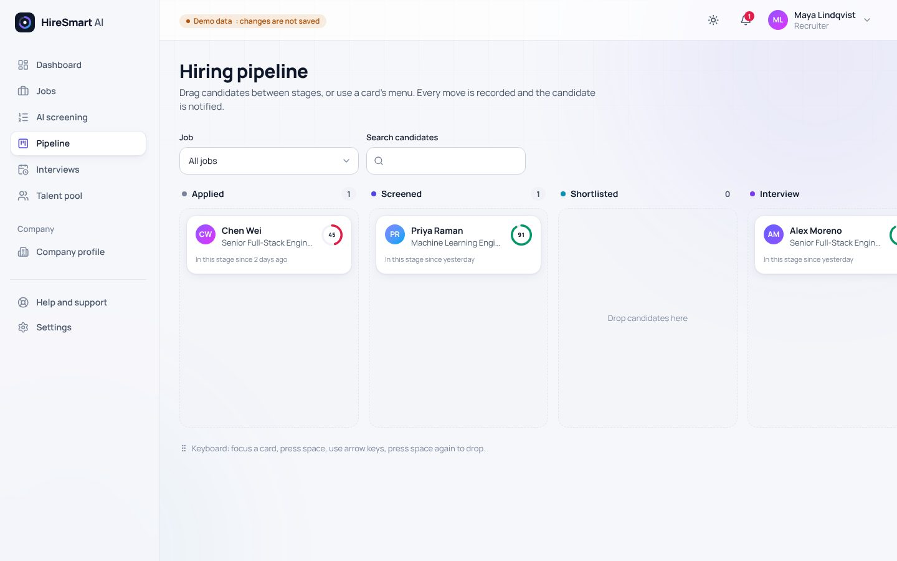
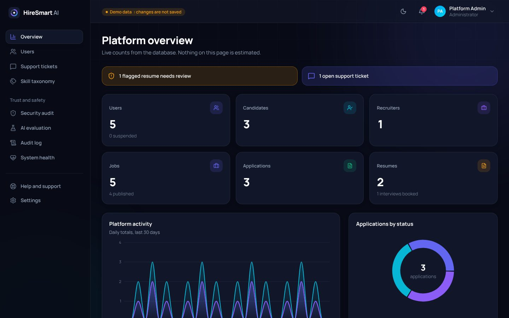
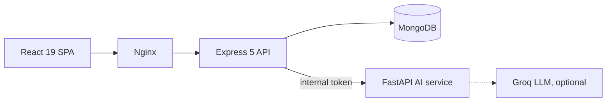

# HireSmart AI

AI-assisted resume screening and job matching. Candidates upload a resume and see how well they fit each open role. Recruiters get applicants ranked by a fixed, published formula. Administrators can audit security events and test the scoring for fairness. Every score shows its four parts, and a person makes every hiring decision.



| Candidate dashboard | Recruiter AI screening |
|---|---|
|  |  |
| **Hiring pipeline (light theme)** | **Admin overview** |
|  |  |

Screenshots use the built-in demo data. All people and companies shown are fictional.

## What it does

**Candidates** upload PDF or DOCX resumes and watch six real processing stages. They review the extracted skills, roles and education before copying them into their profile, then browse and filter jobs. Each match report shows the score and its parts. They can also apply, track every status change, and see which missing skills come up most across the jobs they want.

**Recruiters** paste a job description and get AI-suggested required and preferred skills. They run screening that ranks applicants (with blind review and side-by-side comparison), and move candidates on a drag-and-drop pipeline with a recorded history. They also schedule interviews (clashes are refused) and record structured feedback.

**Administrators** get live platform analytics, user suspension with a required reason, support tickets, the skill taxonomy and its review queue, flagged-document review, a full audit log, fairness evaluation runs, and service health.

## The formula

```
Overall = Skills × 0.50 + Experience × 0.20 + Education × 0.10 + Role × 0.20
Strong Match 80 to 100 · Potential Match 60 to 79.99 · Low Match below 60
```

Skills distinguish exact, alias (ReactJS = React) and related (Docker toward Kubernetes, half credit) matches. Role fit uses MiniLM sentence embeddings. The AI service checks every result against the formula, and the API checks it again before saving. Language models help read documents but never produce or change a number. Details: [docs/matching-algorithm.md](docs/matching-algorithm.md).

## Architecture



| Part | Stack |
|---|---|
| `frontend/` | React 19, TypeScript, Vite 8, Tailwind CSS 4, Framer Motion, Recharts, React Router 7, React Hook Form, Zod, dnd-kit, Playwright |
| `backend/` | Node 20+, Express 5, TypeScript, Mongoose 9, JWT with refresh rotation, bcryptjs, Zod, Multer, Helmet, pino, vitest |
| `ai-service/` | Python 3.11+, FastAPI, Pydantic, PyMuPDF, python-docx, sentence-transformers (all-MiniLM-L6-v2), scikit-learn, Groq API, pytest |
| Ops | Docker, Docker Compose, GitHub Actions, Jenkins, Kubernetes (Kustomize), Nginx |

More: [docs/architecture.md](docs/architecture.md).

## Quick start with Docker

```bash
cp .env.example .env          # replace every change-me value (openssl rand -base64 48)
docker compose up -d --build --wait
docker compose exec backend node dist/seed/seed.js
```

Open http://localhost:8080.

### Seeded accounts

All use the password `HireSmart@2026`. Development only.

| Role | Email |
|---|---|
| Administrator | admin@hiresmart.dev |
| Recruiter | maya.recruiter@hiresmart.dev, daniel.recruiter@hiresmart.dev |
| Candidate | alex.candidate@hiresmart.dev, priya.candidate@hiresmart.dev, sam.candidate@hiresmart.dev, chen.candidate@hiresmart.dev |

Accounts you register yourself start with an empty profile.

## Local development

```bash
# AI service (port 8000)
cd ai-service && python -m venv .venv && source .venv/bin/activate
pip install --index-url https://download.pytorch.org/whl/cpu torch   # optional, enables MiniLM
pip install -r requirements-dev.txt && cp .env.example .env
uvicorn app.main:app --reload --port 8000

# Backend (port 5000), needs MongoDB
cd backend && npm install && cp .env.example .env
npm run seed && npm run dev

# Frontend (port 5173, proxies /api to :5000)
cd frontend && npm install && npm run dev
```

No backend handy? `cd frontend && npm run dev:mock` runs the full UI on in-browser sample data with a visible "Demo data" banner. That layer is compiled out of normal builds, and CI checks the production bundle for it.

Environment variables: [docs/deployment.md](docs/deployment.md).

## Tests

| Suite | Command | Last result |
|---|---|---|
| AI service | `cd ai-service && python -m pytest -q` | 51 passed |
| Backend unit and HTTP | `cd backend && npm test` | 21 passed |
| Backend integration (needs MongoDB) | `MONGO_URI_TEST=mongodb://localhost:27017/hs_test npm test` | Runs in CI; not run locally (no MongoDB available) |
| Frontend UI | `cd frontend && npx playwright test` | 35 passed (desktop and mobile) |
| Live 15-step journey | `E2E_LIVE=1 BASE_URL=http://localhost:8080 npx playwright test` | Runs in CI against Docker Compose; not run locally |

Typecheck and production builds pass for backend and frontend. Kubernetes manifests pass strict schema validation (20/20 resources, v1.30), and `docker compose config` is valid. Full breakdown: [docs/testing.md](docs/testing.md).

## CI/CD and deployment

- **GitHub Actions** (`.github/workflows/ci.yml`): AI, backend (with a MongoDB service) and frontend jobs in parallel, then the live journey on Docker Compose, then image pushes to GHCR on `main`. `deploy.yml` is a manual, approval-gated Kubernetes rollout.
- **Jenkins** (`Jenkinsfile`): the same stages, with a manual approval before deploying.
- **Kubernetes** (`k8s/`): workloads with probes and resource limits, an Ingress, default-deny NetworkPolicies (only the backend can reach the AI service and MongoDB), HPAs, and non-root read-only containers.

Guides: [ci-cd](docs/ci-cd.md), [docker](docs/docker-guide.md), [kubernetes](docs/kubernetes-guide.md).

## Documentation

[Architecture](docs/architecture.md) · [Database schema](docs/database-schema.md) · [API](docs/api.md) · [AI engine](docs/ai-engine.md) · [Matching algorithm](docs/matching-algorithm.md) · [Security](docs/security.md) · [Deployment](docs/deployment.md) · [Docker](docs/docker-guide.md) · [Kubernetes](docs/kubernetes-guide.md) · [CI/CD](docs/ci-cd.md) · [Testing](docs/testing.md) · [User guide](docs/user-guide.md) · [Design system](docs/design-system.md) · [Progress log](DEVELOPMENT_PROGRESS.md)

## Known limitations

- **Not yet run end to end against MongoDB.** The backend integration suite and the live Playwright journey are written and wired into CI but were not executed in the build environment, where MongoDB could not be started. The backend-to-AI contract was tested against a running AI service.
- **MiniLM and Groq were not exercised live.** Model downloads and the Groq API were unreachable during development. Tests ran on the TF-IDF fallback, with Groq success and failure simulated. The Docker image downloads MiniLM at build time.
- **Docker images were not built locally** (no Docker daemon in the build environment). Compose and Kubernetes files were validated statically.
- **OAuth** (Google and LinkedIn OpenID Connect) is implemented but untested against real providers. Without credentials the buttons are disabled and say why.
- **No email delivery.** Notifications are in-app only; the email preference is stored for a future provider.
- **Scaling.** Resumes live on a volume, so the backend runs one replica in Kubernetes unless you provide ReadWriteMany storage. Rate limits are per process.
- **Omitted on purpose.** No testimonials section, to avoid inventing customer quotes. GSAP, Three.js and tsParticles are not used: Framer Motion and a 1.6 KB canvas cover the motion with less weight.
- **Smaller gaps.** In-app resume preview is PDF only (DOCX can be downloaded), and the interview calendar has week and list views but no month view.
