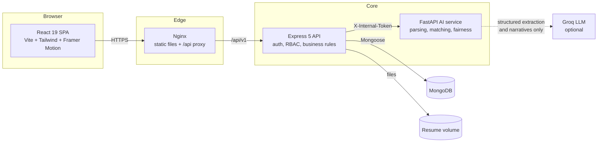
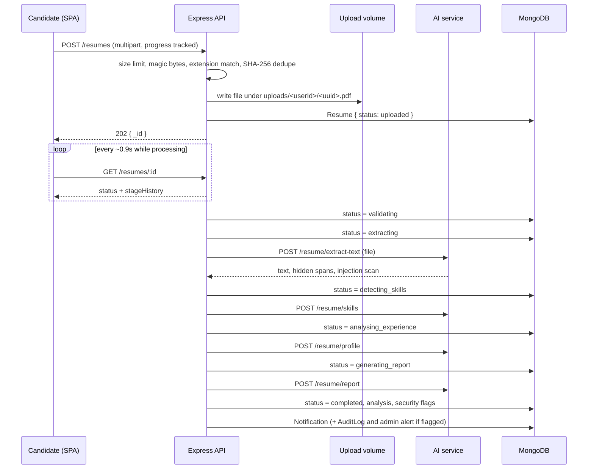
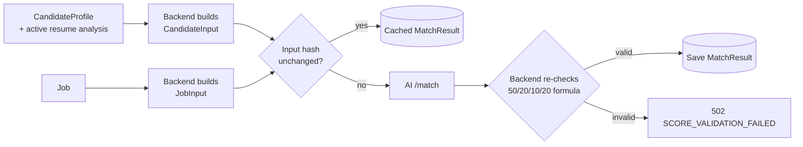

# Architecture

HireSmart AI is three services and a database. Each service owns one job, and only the Express API touches MongoDB.



## Responsibilities

| Component | Owns | Never does |
|---|---|---|
| Frontend (`frontend/`) | UI, routing, optimistic updates, client-side validation | Store primary data in browser storage. The access token lives in memory only. |
| Express API (`backend/`) | Authentication, refresh-token rotation, RBAC, every database write, file storage, audit log, notifications | Run AI logic. It sends structured data to the AI service and re-checks the score it gets back. |
| AI service (`ai-service/`) | Text extraction, skill taxonomy, the matching formula, prompt-injection scanning, fairness evaluation | Touch MongoDB, or accept requests without the shared internal token |
| MongoDB | Users, profiles, jobs, applications, match results, audit log and the rest of the 15 collections | |

## Request paths

Browser calls go to `/api/v1/*` on the same origin. In Docker Compose, Nginx inside the frontend container proxies them to `backend:5000`. In Kubernetes, the Ingress routes `/api` to the backend Service directly. Keeping the API on the same origin means the `hs_refresh` cookie stays first-party (`SameSite=Lax`, `HttpOnly`, scoped to `/api/v1/auth`).

The AI service has no public route. In Compose it sits on an `internal` network shared only with the backend; in Kubernetes a NetworkPolicy allows ingress only from backend pods.

## Resume processing

Uploads return `202 Accepted` straight away. The API then runs the pipeline in the background and writes each stage to the `Resume` document before starting it, so the progress the candidate sees is the real state.



## Matching



Protected attributes never reach the scorer: the AI service's input models ignore unknown fields, and the free-text summary is left out of the semantic role text.

## Human in the loop

The only status change automation can make is `applied → screened`, recorded with `actor: system`. Shortlisting, interviews, hiring and rejection are recruiter actions. Each one is logged in `statusHistory` and the audit log, and the candidate is notified.

## Directory layout

```
hiresmart-ai/
├── ai-service/          FastAPI app, taxonomy data, pytest suite
├── backend/             Express 5 + TypeScript API, Mongoose models, seed, vitest suites
├── frontend/            React 19 SPA, design system, Playwright suites, Nginx config
├── k8s/                 Kustomize manifests (namespace, workloads, ingress, network policies, HPA)
├── docs/                This documentation
├── .github/workflows/   CI (tests, live journey, image push) and manual deploy
├── Jenkinsfile          Equivalent Jenkins pipeline
└── docker-compose.yml   Full local stack
```
