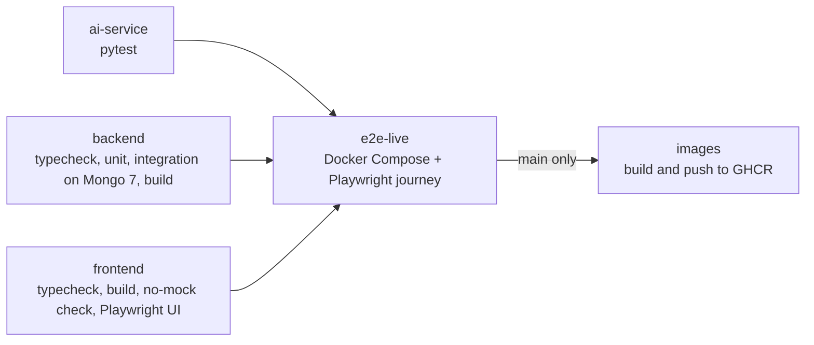

# CI/CD

## GitHub Actions

`.github/workflows/ci.yml` runs on every pull request and on pushes to `main`.

| Job | What it runs |
|---|---|
| `ai-service` | `python -m pytest -q` (TF-IDF fallback, no torch needed) |
| `backend` | `npm run typecheck`, `npm test` with a MongoDB 7 service container (`MONGO_URI_TEST`), so the 13-step integration suite runs here, then `npm run build` |
| `frontend` | typecheck, production build, a grep proving the demo data layer is absent from the live bundle, then the Playwright UI suite (desktop and mobile projects) |
| `e2e-live` | Generates random secrets, `docker compose up --build --wait`, seeds, runs `tests/e2e/live-journey.spec.ts` (the 15-step journey) against the real stack, dumps logs on failure |
| `images` | `main` only: builds and pushes `frontend`, `backend` and `ai-service` to `ghcr.io/<repo>/<service>:<sha>` and `:latest` with layer caching |

`.github/workflows/deploy.yml` is a manual workflow. It takes an image tag, runs in the `production` environment (add required reviewers there), applies `k8s/` and waits for each rollout. It needs a `KUBECONFIG_B64` secret.

## Jenkins

`Jenkinsfile` mirrors the same flow:

1. **Test** in parallel: AI service (python:3.11-slim, JUnit report), backend (node:22), frontend (official Playwright image).
2. **Integration (Compose)**: builds and starts the stack with throwaway secrets, seeds it, runs the backend integration suite against the Compose MongoDB and the live Playwright journey, then tears everything down including volumes.
3. **Push images** (main only), using the `registry-creds` credential.
4. **Deploy to Kubernetes** (main only) after a manual `input` approval, using the `kubeconfig-hiresmart` secret file.

## Branch protection

Require the `ai-service`, `backend`, `frontend` and `e2e-live` checks before merging to `main`.
