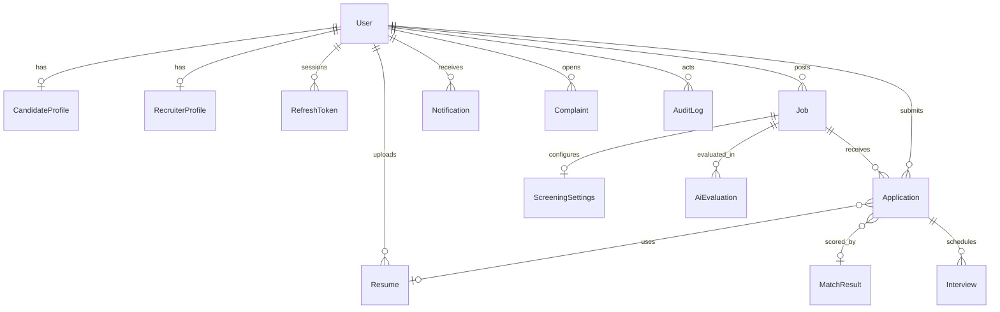

# Database schema

MongoDB with Mongoose 9. All models use `timestamps` (`createdAt`, `updatedAt`) unless noted. Definitions live in `backend/src/models/`.

## Collections

| Model | Key fields | Indexes |
|---|---|---|
| **User** | `name`, `email` (unique, lowercase), `passwordHash` (select: false), `role` (candidate, recruiter, admin), `status` (active, suspended), `authProvider`, `providerId`, `failedLoginAttempts`, `lockUntil`, `preferences.theme` | email unique, role, status, providerId (sparse), createdAt |
| **RefreshToken** | `user`, `tokenHash` (HMAC-SHA256, unique), `family`, `expiresAt`, `revokedAt`, `replacedBy`, `userAgent`, `ip` | TTL on `expiresAt`, family, user |
| **CandidateProfile** | `user` (unique), `headline`, `summary`, `education[]` (level 0 to 5), `experience[]`, `skills[]`, `projects[]`, `certifications[]`, `socialLinks`, `totalExperienceYears`, `highestEducationLevel`, `activeResume`, `bookmarkedJobs[]`, `openToRecruiters`, `completeness` | user unique, `skills.name`, openToRecruiters |
| **RecruiterProfile** | `user` (unique), `company`, `title`, `companyWebsite`, `companySize`, `industry`, `location`, `about` | user unique |
| **Resume** | `candidate`, `originalName` (sanitised), `storedName` (UUID, select: false), `fileType`, `size`, `sha256`, `status` (pipeline stage), `stageHistory[]`, `text` (select: false), `analysis`, `security` (riskScore, riskLevel, flagged, findings), `reviewStatus`, `isActive`, `deletedAt` | candidate + createdAt, status, security.flagged, reviewStatus, deletedAt |
| **Job** | `recruiter`, `company`, `title`, `description`, `requiredSkills[]`, `preferredSkills[]`, `minExperienceYears`, `educationLevel`, `educationRequired`, `employmentType`, `workMode`, `location`, `salary`, `status` (draft, published, closed), `views`, `applicationsCount`, `security` | recruiter, status + publishedAt, workMode, requiredSkills |
| **Application** | `job`, `candidate`, `recruiter`, `resume`, `status`, `statusHistory[]` (from, to, by, actor, note, at), `coverLetter`, `matchResult`, `matchScore`, `matchCategory`, `recruiterNotes` | job + candidate unique, recruiter + status + createdAt |
| **MatchResult** | `candidate`, `job`, `resume`, `inputHash`, `overallScore`, `category`, `components`, matched/related/missing skills, `strengths`, `gaps`, `explanation`, `narrative`, `recommendations`, `modelVersion`, `embeddingBackend`, `llmUsed`, `validated` (required) | candidate + job unique, job |
| **Interview** | `application`, `job`, `candidate`, `recruiter`, `scheduledAt`, `durationMinutes`, `type`, `meetingUrl`, `location`, `status`, `feedback` (rating 1 to 5, strengths, concerns, recommendation) | application, candidate, recruiter, scheduledAt, status |
| **Notification** | `user`, `type`, `title`, `message`, `link`, `readAt` | user + createdAt, TTL 180 days |
| **Complaint** | `user`, `subject`, `description`, `category`, `priority`, `status`, `responses[]`, `history[]`, `resolvedAt` | user, priority, status |
| **Skill** | `name` (unique), `category`, `aliases[]`, `related[]`, `status` (approved, pending, rejected), `source` (seed, admin, resume), `occurrences` | name unique, category, status |
| **ScreeningSettings** | `job` (unique), `autoScreenOnApply`, `highlightThreshold`, `blindReview` | job unique |
| **AuditLog** | `actor`, `actorRole`, `actorEmail`, `action`, `category`, `severity`, `targetType`, `targetId`, `ip`, `userAgent`, `metadata` | actor, action, category, severity, createdAt, TTL (`AUDIT_RETENTION_DAYS`, default 365) |
| **AiEvaluation** | `mode` (job, benchmark), `job`, `runBy`, `candidateCount`, `summary`, `result`, `modelVersion`, `embeddingBackend` | |

## Data isolation

- Candidates read and write only their own profile, resumes, applications and matches (filters always include `candidate: req.user.id`).
- Recruiters see applications where `recruiter` is them. They can read a candidate's profile only if that candidate applied to one of their jobs or opted into the talent pool, and download a resume only if it was submitted to one of their jobs.
- Administrators see everything except password hashes, refresh-token hashes and extracted resume text, which are `select: false`.

## Transactions and consistency

The API is written to work without multi-document transactions, so it runs on a standalone `mongod`:

- Registration creates the user, then the profile; if the profile insert fails, the user is deleted.
- Applications use a unique `(job, candidate)` index; duplicates return 409.
- Match results use an upsert on `(candidate, job)`.
- Counters (`applicationsCount`, `views`) use `$inc`.

## Retention and deletion

| Data | Rule |
|---|---|
| Refresh tokens | Removed by TTL at expiry |
| Notifications | Removed after 180 days |
| Audit log | Removed after `AUDIT_RETENTION_DAYS` (default 365) |
| Resumes | Soft delete: the file and extracted text are removed immediately, metadata stays so existing applications keep their references |
| Interrupted processing | On startup, resumes stuck mid-pipeline are marked failed so candidates can retry |

## Seed data

`npm run seed` (or `node dist/seed/seed.js` in the container) inserts the skill taxonomy, one admin, two recruiters, four candidates, six published jobs, one draft and seven applications. All are fictional. Accounts are created only if missing; `--reset` wipes collections and is refused in production. Seeded accounts share the password `HireSmart@2026`.

New accounts created through the API always start with an empty profile.
